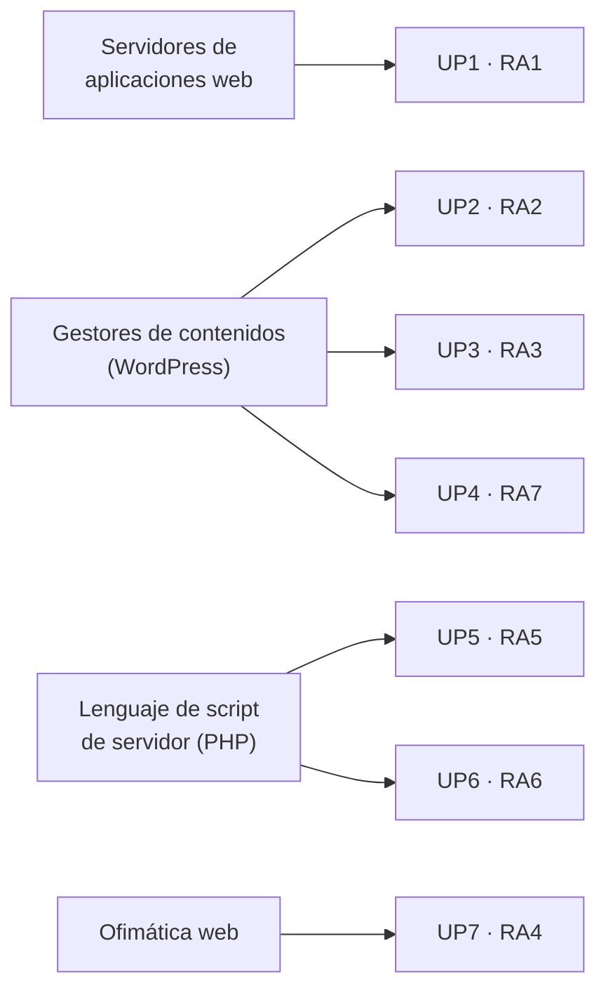

# 🗂️ Organización y recursos

## Cómo está organizado el curso

Los contenidos se reparten en siete unidades de programación (UP). Cada unidad tiene su propia sección en este sitio, con la misma estructura:

| Sección | Qué contiene |
|:--------|:-------------|
| **Portada de la unidad** | Resultado de aprendizaje, criterios de evaluación y contenidos que se trabajan. |
| **Contenidos** | Apuntes de cada tema, con el código listo para copiar. |
| **Diapositivas** | Las presentaciones de clase, cuando el tema las tiene. |
| **Prácticas** | Enunciados de las prácticas evaluables, cada uno con su rúbrica. |

## Bloques de contenido

| Bloque | Unidades | Temas |
|:-------|:---------|:------|
| Instalación de servidores de aplicaciones web | [UP1](/up1/) | Arquitecturas web, servidor web y de aplicaciones, puesta en marcha del entorno. |
| El CMS WordPress | [UP2](/up2/), [UP3](/up3/), [UP4](/up4/) | Instalación, primeros pasos, gestión de contenidos, personalización de la interfaz, extensiones, usuarios y seguridad, administración y mantenimiento, adaptación y documentación. |
| Lenguaje de script: PHP | [UP5](/up5/), [UP6](/up6/) | Introducción, expresiones y control de flujo, funciones, matrices, formularios, cookies, sesiones y autenticación, acceso a datos. |
| Aplicaciones de ofimática web | [UP7](/up7/) | Tipos de aplicaciones, instalación, integración en la intranet, usuarios y control de accesos. |

## Software necesario

| Herramienta | Para qué se usa |
|:------------|:----------------|
| **Visual Studio Code** | Editor de código para el desarrollo web. Se amplía con extensiones (por ejemplo, *PHP Intelephense*) para la interpretación y depuración del código. |
| **Stack de servicios: AMPPS o XAMPP** | Servidor web Apache, base de datos MySQL/MariaDB y PHP en una sola instalación, para trabajar en local. |
| **Navegador web** | Cliente de las aplicaciones y herramientas de desarrollador. |

::: tip-box Instala el entorno cuanto antes
Las prácticas de todas las unidades se hacen sobre el stack local. En [UP1 · Herramientas y puesta en marcha](/up1/contenidos/2-herramientas-entorno) tienes los pasos.
:::

## Periodos de formación

El segundo curso se reparte en dos periodos:

1. **Primer periodo, en el centro**: aproximadamente de septiembre a febrero, con horario completo.
2. **Segundo periodo, en la empresa**: aproximadamente de marzo a junio, con horario completo.

Las fechas concretas de evaluación de cada curso se publican en Aules.

## Bibliografía y webgrafía

**Libros y documentación**

- Nixon, Robin (2021). *Aprender PHP, MySQL y JavaScript* (5.ª edición, en castellano).
- Nixon, Robin (2023). *Learning PHP, MySQL & JavaScript* (7.ª edición, en inglés).
- Heurtel, Olivier. *PHP 8. Desarrolle un sitio web dinámico e interactivo* (2.ª edición).
- [Documentación oficial de PHP](https://www.php.net/manual/es/).
- [Documentación oficial de WordPress](https://wordpress.org/documentation/).

**Apuntes de otros docentes**

- Medrano, Aitor. [Apuntes del módulo Desarrollo Web en Entorno Servidor](https://aitor-medrano.github.io/dwes2122/).
- Sintes Marco, Bartolomé. [mclibre.org](https://www.mclibre.org/).

---

**Siguiente paso:** [Resultados de aprendizaje →](./2-resultados-aprendizaje)
