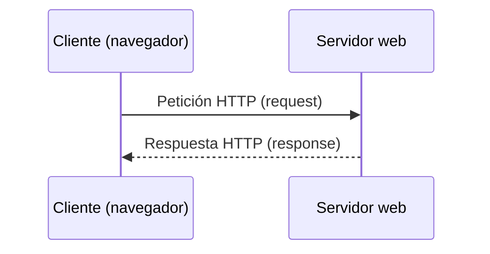
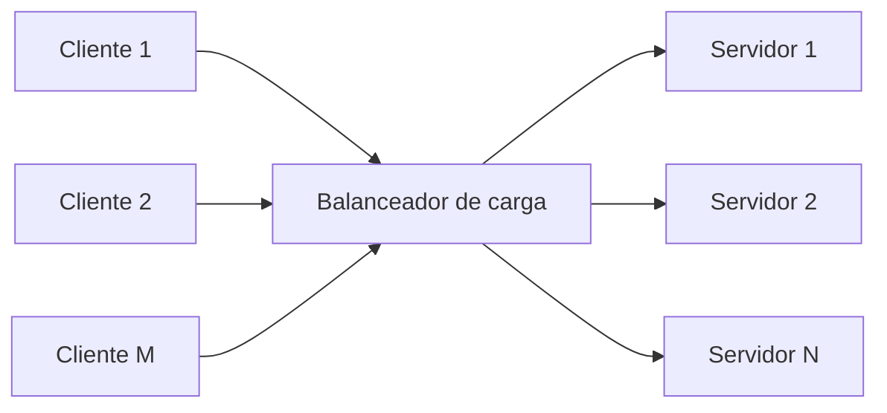
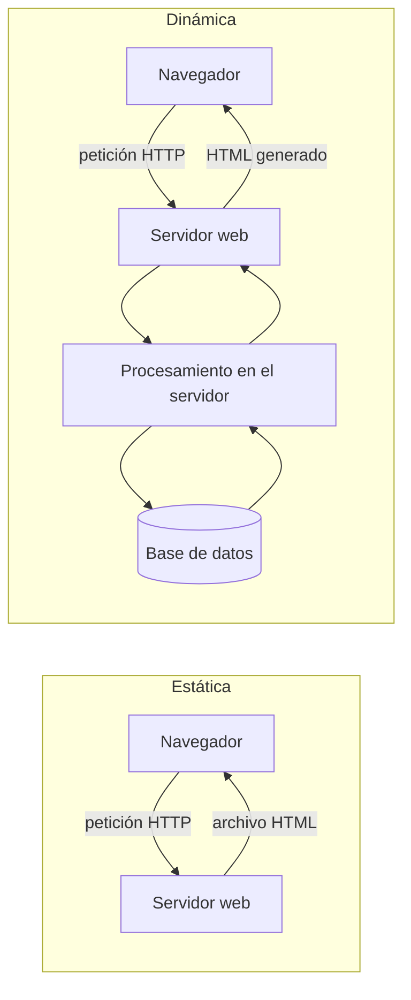
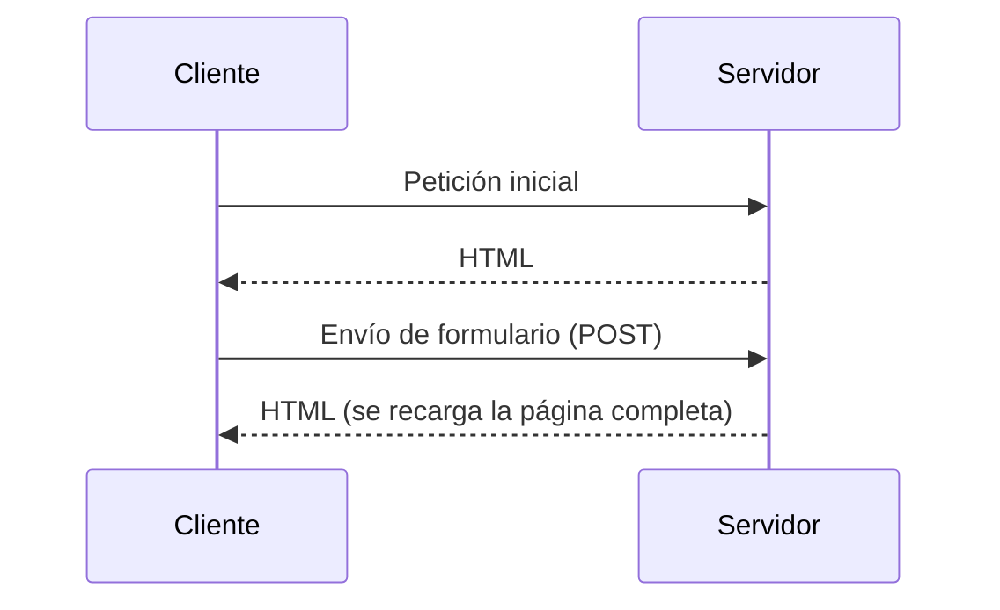
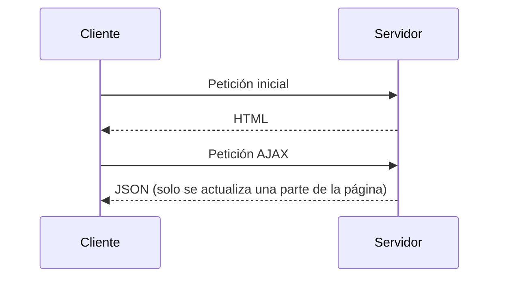
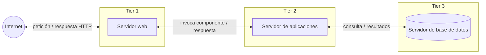
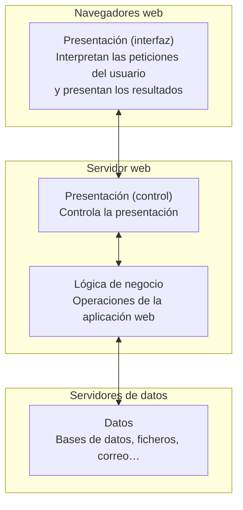
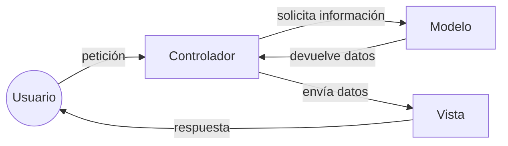

# 🏗️ Arquitecturas web

<ExportPDF />

Las arquitecturas web definen la forma en que las páginas de un sitio web están estructuradas y enlazadas entre sí. Las aplicaciones web se basan en el modelo **cliente-servidor**.

## Cliente / servidor

Uno o varios clientes acceden a un servidor. En las aplicaciones web, el cliente es el **navegador web**.

El cliente hace la petición (*request*), normalmente con el método GET del protocolo HTTP y por el puerto 80 (HTTP) o 443 (HTTPS), y el servidor responde (*response*).

Las arquitecturas actuales sustituyen el servidor único por un **balanceador de carga**, de manera que N servidores dan respuesta a M clientes.

## Página web dinámica

Si la página web únicamente contiene HTML y CSS se considera una **página estática**: el servidor devuelve siempre el mismo archivo.

Para generar una **página dinámica**, donde el contenido cambia, hoy en día hay dos alternativas:

- Utilizar un **lenguaje de servidor** que genere el contenido, ya sea mediante el acceso a una base de datos o a servicios externos.
- Utilizar **servicios REST** de terceros invocados desde JavaScript.

Las tecnologías empleadas, y los perfiles de desarrollo asociados, para la generación de páginas dinámicas son:

| Perfil | Herramienta | Tecnología |
|:-------|:------------|:-----------|
| *Front-end* / cliente | Navegador web | HTML + CSS + JavaScript |
| *Back-end* / servidor | Servidor web + base de datos | PHP, Python, Ruby, Java / JSP, .NET |

::: tip-box Perfil full-stack
Cuando una oferta de trabajo hace referencia a un *full-stack developer*, busca un perfil que domine tanto el *front-end* como el *back-end*.
:::

## Single Page Application

Hoy en día, gran parte del desarrollo web está pasando de una arquitectura cliente-servidor clásica, donde el cliente realiza una llamada al *backend* y recibe una página completa, a una arquitectura **SPA** (*Single Page Application*). En una SPA el cliente gana mucho más peso: sigue una programación reactiva y accede a servicios remotos REST que realizan las operaciones, comunicándose mediante JSON.

::: tabs

== Ciclo de vida tradicional

== Ciclo de vida de una SPA

:::

## Arquitectura de tres capas

Hay que distinguir entre capas **físicas** (*tier*) y capas **lógicas** (*layer*).

### Capa física (tier)

Una capa física supone un elemento de hardware nuevo, separado físicamente del resto. Las capas físicas más alejadas del cliente están más protegidas, tanto por cortafuegos como por VPN.

Ejemplo de arquitectura en tres capas físicas (*3 tier*):

- Servidor web
- Servidor de aplicaciones
- Servidor de base de datos

::: warning-box Cluster en tiers
No hay que confundir las capas con la cantidad de servidores. Actualmente se trabaja con arquitecturas con múltiples servidores en una misma capa física mediante un *cluster*, para ofrecer tolerancia a errores y escalabilidad horizontal.
:::

### Capas lógicas (layer)

Las capas lógicas organizan el **código** según su funcionalidad:

| Capa | Función | Tecnologías habituales |
|:-----|:--------|:-----------------------|
| **Presentación** | Interfaz con la que interactúa el usuario. | HTML5, CSS, JavaScript |
| **Negocio / aplicación / proceso** | Reglas y operaciones de la aplicación. | PHP, Java, .NET, C#, Python |
| **Datos / persistencia** | Almacenamiento y recuperación de la información. | MySQL, Oracle, PostgreSQL, SQL Server, MongoDB |

Cada una de las capas se puede implementar con diferentes lenguajes de programación y herramientas.

Las tres capas lógicas se reparten entre las tres capas físicas de esta manera:

### MVC

*Model-View-Controller* o **Modelo-Vista-Controlador** es un modelo de arquitectura que separa los datos y la lógica de negocio de la interfaz de usuario y del componente encargado de gestionar los eventos y las comunicaciones.

Separar los componentes en elementos conceptuales permite reutilizar el código y mejorar su organización y mantenimiento. Sus elementos son:

- **Modelo**: representa la información y gestiona todos los accesos a ella, tanto consultas como actualizaciones, que normalmente provienen de una base de datos. Se accede a él a través del controlador.
- **Controlador**: responde a las acciones del usuario y realiza peticiones al modelo para solicitar información. Tras recibir la respuesta del modelo, envía los datos a la vista.
- **Vista**: presenta al usuario de forma visual el modelo y los datos preparados por el controlador. El usuario interactúa con la vista y realiza nuevas peticiones al controlador.

## Decisiones de diseño

Antes de elegir tecnologías para una aplicación web conviene hacerse estas preguntas:

- ¿Qué tamaño tiene el proyecto?
- ¿Qué lenguajes de programación conozco?
- ¿Vale la pena el esfuerzo de aprender uno nuevo?
- ¿Voy a usar herramientas de código abierto o herramientas propietarias? ¿Cuál es el coste de utilizar soluciones comerciales?
- ¿Voy a programar la aplicación yo solo o formaré parte de un grupo de programadores?
- ¿Cuento con algún servidor web o gestor de base de datos disponible, o puedo decidir libremente utilizar el que crea necesario?
- ¿Qué tipo de licencia voy a aplicar a la aplicación que desarrolle?

::: note-box Fuente
Adaptado de los apuntes de Aitor Medrano y Luis Alemañ, *Desarrollo Web en Entorno Servidor*, licencia CC BY-NC-SA. Ver [Créditos y fuentes](/general/contenidos/4-creditos).
:::

---

**Siguiente paso:** [Herramientas y puesta en marcha →](./2-herramientas-entorno)
