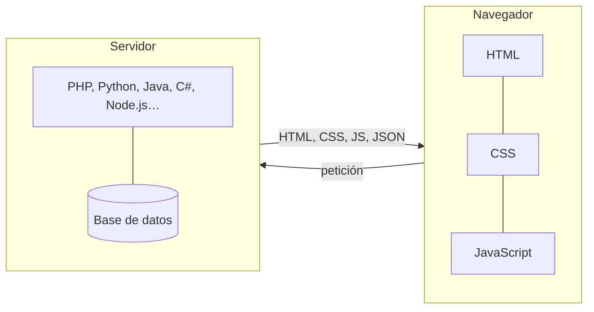

# 🧭 Tecnologías y entorno de desarrollo

<ExportPDF />

Este tema repasa las piezas que intervienen cuando se pide una página web: cómo se localiza un recurso, qué tipos de servidor se pueden contratar, qué software los atiende y qué lenguajes se ejecutan en cada lado. Termina con las herramientas con las que se trabaja a diario en el módulo.

## Cómo se localiza un recurso en la web

Para pedir un recurso a un servidor, el cliente necesita cinco datos:

| Dato | Para qué sirve | Ejemplo |
|:-----|:---------------|:--------|
| **Protocolo** | Las reglas de la comunicación. | `https` |
| **Nombre del servidor** | El dominio, que el DNS traduce a una dirección IP. | `www.ejemplo.es` |
| **Puerto** | El servicio concreto que escucha en esa máquina. Si se omite, se usa el del protocolo. | `443` |
| **Ruta** | La carpeta del recurso dentro del servidor. | `/img/` |
| **Recurso** | El nombre del archivo o del recurso pedido. | `foto.jpg` |

Todo junto forma una **URL**:

```text
protocolo://servidor:puerto/ruta/recurso
https://www.ejemplo.es:443/img/foto.jpg
```

::: warning-box Máquina servidor y software servidor
No hay que confundir el **equipo** que hace de servidor con el **programa** servidor. Un mismo equipo puede ejecutar varios programas servidor (web, base de datos, correo) y también programas cliente. Cada programa servidor escucha en su propio puerto: un servidor web suele atender HTTP en el 80 y HTTPS en el 443, y puede atender otras webs en puertos como el 8080.
:::

### Direcciones y nombres

Cada equipo de una red tiene una dirección IP:

- **IPv4**: cuatro números de 0 a 255 separados por puntos, por ejemplo `192.168.0.1`.
- **IPv6**: ocho grupos de cuatro cifras hexadecimales separados por dos puntos, por ejemplo `2001:0db8:0000:0000:0000:ff00:0042:8329`.

Como las direcciones son difíciles de recordar, se usan nombres de dominio. Los servidores **DNS** traducen el nombre a la dirección IP antes de que el navegador se conecte.

### Métodos y códigos de respuesta HTTP

En cada petición el cliente indica qué quiere hacer con el recurso mediante un **método**:

| Método | Qué pide | Operación equivalente |
|:-------|:---------|:----------------------|
| `GET` | Obtener un recurso. Los parámetros viajan en la URL. | Leer |
| `POST` | Enviar datos al servidor, en el cuerpo de la petición. | Crear |
| `PUT` | Sustituir un recurso por el que se envía. | Actualizar |
| `DELETE` | Borrar un recurso. | Borrar |

El servidor contesta siempre con un **código de estado**, que indica cómo ha ido la petición:

| Familia | Significado | Ejemplos |
|:-------:|:------------|:---------|
| `2xx` | Correcto | `200 OK`, `201 Created` |
| `3xx` | Redirección | `301 Moved Permanently`, `302 Found` |
| `4xx` | Error del cliente | `401 Unauthorized`, `403 Forbidden`, `404 Not Found` |
| `5xx` | Error del servidor | `500 Internal Server Error`, `503 Service Unavailable` |

::: tip-box Compruébalo
Abre las herramientas de desarrollador del navegador (<kbd>F12</kbd>), ve a la pestaña **Red** y recarga cualquier página. Verás cada petición con su método, su código de estado y su tiempo de respuesta.
:::

### Middleware

Entre la aplicación cliente y la aplicación servidora hay una capa de software intermedio, el **middleware**, que se encarga de la comunicación para que ninguna de las dos tenga que resolverla por su cuenta.

- **Middleware general**: los servicios que necesita cualquier comunicación, como la pila TCP/IP, la resolución de nombres o la autenticación.
- **Middleware de servicio**: el que se asocia a un servicio concreto, como los conectores de bases de datos (ODBC, JDBC, PDO) o las bibliotecas de mensajería entre aplicaciones.

## Dónde se aloja una aplicación web

Al contratar dónde publicar una aplicación se elige, en realidad, cuántos recursos de hardware se tienen y cuánto control sobre ellos.

| Modalidad | Qué se contrata | Control | Coste | Adecuado para |
|:----------|:----------------|:--------|:------|:--------------|
| **Alojamiento compartido** | Una parte de un servidor que comparten muchos clientes. | Bajo: solo el panel del proveedor. | Bajo | Webs pequeñas y CMS sin requisitos especiales. |
| **Servidor privado virtual (VPS)** | Una máquina virtual con recursos reservados. | Alto: acceso de administrador al sistema. | Medio | Aplicaciones que necesitan configuración propia. |
| **Servidor dedicado** | Una máquina física completa. | Total. | Alto | Cargas grandes o requisitos de aislamiento. |
| **Infraestructura como servicio (IaaS)** | Máquinas, red y almacenamiento en la nube, que se pagan por uso y se amplían bajo demanda. | Alto. | Variable | Proyectos que crecen o tienen picos de tráfico. |

Los principales proveedores de IaaS son Amazon Web Services, Microsoft Azure y Google Cloud Platform.

## Software servidor web

| Servidor | Características | Puntos a tener en cuenta |
|:---------|:----------------|:-------------------------|
| **Apache HTTP Server** | Libre y multiplataforma. Funcionalidad ampliable con módulos y configuración por directorio con `.htaccess`. | Muy documentado. Cada módulo añadido es código más que mantener actualizado. |
| **Nginx** | Libre, ligero y con muy buen rendimiento ante muchas conexiones simultáneas. También hace de proxy inverso y balanceador de carga. | No ejecuta PHP por sí mismo: lo delega en PHP-FPM. No admite `.htaccess`. |
| **Microsoft IIS** | Integrado en Windows Server. Es el habitual para aplicaciones ASP.NET. | Propietario y ligado a Windows. |
| **Apache Tomcat** | Contenedor de *servlets* y páginas JSP para aplicaciones Java. | Se suele colocar detrás de Apache o Nginx. |

## Páginas estáticas y dinámicas

- Una **página estática** muestra siempre el mismo contenido hasta que alguien edita sus archivos. Está formada por HTML y CSS, y puede llevar JavaScript que se ejecuta en el navegador. Ejemplo: la página de presentación de una empresa.
- Una **página dinámica** se genera en el momento de la petición. Normalmente un programa en el servidor consulta una base de datos y construye el HTML con lo que obtiene. Ejemplo: la portada de un periódico digital, que cambia cada pocos minutos.

Entre las aplicaciones dinámicas destacan cuatro familias:

| Tipo | Qué hace | Ejemplos |
|:-----|:---------|:---------|
| **Comercio electrónico** | Catálogo, carrito, pagos y gestión de pedidos. | WooCommerce, PrestaShop, Magento |
| **Gestor de contenidos (CMS)** | Crear y publicar contenidos desde un panel, sin programar. | WordPress, Joomla, Drupal |
| **Aplicación web a medida** | Programas completos que funcionan en el navegador. | Banca en línea, intranets |
| **Plataforma de aprendizaje (LMS)** | Cursos, actividades y calificaciones. | Moodle |

Las páginas dinámicas se estudian en la [UP5](/up5/), y los gestores de contenidos en la [UP2](/up2/).

## Lenguajes en el cliente y en el servidor



| | Lenguajes del lado del cliente | Lenguajes del lado del servidor |
|:--|:-------------------------------|:--------------------------------|
| **Dónde se ejecutan** | En el navegador del usuario. | En el servidor, antes de enviar la respuesta. |
| **El usuario ve el código** | Sí. | No: solo recibe el resultado. |
| **Para qué se usan** | Interfaz, validaciones inmediatas, interactividad. | Acceso a datos, lógica de negocio, seguridad. |
| **Ejemplos** | JavaScript, TypeScript (se traduce a JavaScript), WebAssembly. | PHP, Python, Java, C#, Ruby, Go, JavaScript con Node.js. |

En el cliente, además, se usan bibliotecas y *frameworks* que facilitan construir interfaces, como React, Vue, Angular o Svelte. En el servidor, cada lenguaje tiene los suyos: Laravel y Symfony (PHP), Django y Flask (Python), Spring (Java), ASP.NET (C#) o Express (Node.js).

::: info-box Por qué PHP en este módulo
PHP es el lenguaje de WordPress, Joomla, Drupal, Moodle y Nextcloud, que son las aplicaciones que se implantan en el módulo. Saber leerlo y modificarlo es lo que permite adaptarlas.
:::

## El entorno de desarrollo

### Editores e IDE

- Un **editor de código** es ligero y se amplía con extensiones. Ejemplos: Visual Studio Code, Sublime Text.
- Un **entorno de desarrollo integrado (IDE)** reúne editor, depurador, gestión de proyectos y herramientas de prueba. Ejemplos: PhpStorm, NetBeans, Eclipse.

En el módulo se usa **Visual Studio Code**, como se explica en [Herramientas y puesta en marcha](./2-herramientas-entorno).

### Control de versiones

Un sistema de control de versiones registra cada cambio en los archivos de un proyecto, permite volver a cualquier versión anterior y facilita que varias personas trabajen en el mismo código. El más extendido es **Git**, que se trata en el [tema siguiente](./4-control-versiones-git).

### Herramientas de bases de datos

| Herramienta | Tipo | Uso |
|:------------|:-----|:----|
| **phpMyAdmin** | Aplicación web | Administrar MySQL/MariaDB desde el navegador. Viene con XAMPP y AMPPS. |
| **Adminer** | Aplicación web | Alternativa a phpMyAdmin en un único archivo PHP. |
| **MySQL Workbench** | Aplicación de escritorio | Diseño de modelos, consultas y administración de MySQL. |
| **DBeaver** | Aplicación de escritorio | Cliente universal para muchos sistemas gestores. |
| Cliente `mysql` | Línea de órdenes | Administración rápida y automatizable desde la terminal. |

### Pilas de software

Una **pila** (*stack*) es el conjunto de programas que hacen falta para que una aplicación funcione. Su nombre suele salir de las iniciales de sus componentes:

| Pila | Componentes |
|:-----|:------------|
| **LAMP** | Linux, Apache, MySQL/MariaDB, PHP |
| **LEMP** | Linux, Nginx (*Engine-X*), MySQL/MariaDB, PHP |
| **WAMP / MAMP** | Igual que LAMP, sobre Windows o macOS |
| **XAMPP / AMPPS** | Distribuciones «todo en uno» multiplataforma con Apache, MariaDB, PHP y Perl |
| **MEAN / MERN** | MongoDB, Express, Angular o React, Node.js: todo en JavaScript |

### Depuración y análisis del código PHP

- **Mostrar los errores en desarrollo.** Con `display_errors = On` y `error_reporting = E_ALL` en `php.ini`, PHP muestra en la página los avisos y errores. En producción se desactiva y los errores se envían al registro.
- **Xdebug.** Extensión de PHP que permite ejecutar el código paso a paso desde el editor, con puntos de ruptura y consulta de variables.
- **`var_dump()` y `print_r()`.** Muestran el contenido y el tipo de una variable. Son la forma más rápida de comprobar qué llega de un formulario.
- **Analizadores estáticos.** Herramientas como PHPStan o Psalm revisan el código sin ejecutarlo y avisan de errores de tipos o de código inalcanzable.
- **Escáneres de seguridad.** Herramientas como OWASP ZAP prueban una aplicación en marcha en busca de vulnerabilidades habituales, como la inyección de SQL o el XSS.

::: danger-box Nunca muestres los errores en producción
Un mensaje de error de PHP puede revelar rutas del servidor, nombres de tablas o fragmentos de código. En un servidor público, `display_errors` debe estar desactivado.
:::

### Asistentes de inteligencia artificial

Los asistentes de IA generativa ayudan a escribir y explicar código, a redactar textos o a generar imágenes. En este módulo se pueden usar para **entender** un error o una función, pero hay que tener en cuenta que:

- Pueden dar respuestas incorrectas con total seguridad. Todo lo que propongan hay que probarlo.
- El código que generan puede contener vulnerabilidades.
- En las prácticas evaluables se valora tu trabajo: lo que entregues tienes que poder explicarlo.

::: note-box Fuente
Tema elaborado a partir de los contenidos del aula de IAW del CEEDCV (Mara Vañó Alonso, curso 2024-2025). Ver [Créditos y fuentes](/general/contenidos/4-creditos).
:::

---

**Siguiente paso:** [Control de versiones con Git y GitHub →](./4-control-versiones-git)
