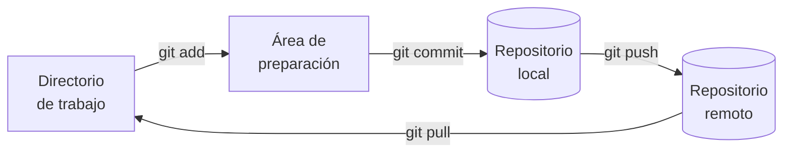
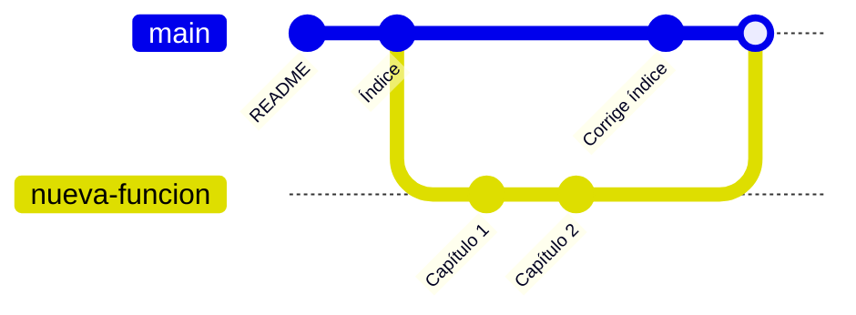

# 🌿 Control de versiones con Git y GitHub

<ExportPDF />

**Git** es un sistema de control de versiones distribuido: guarda la historia completa de un proyecto, permite volver a cualquier versión anterior y facilita que varias personas trabajen a la vez sobre el mismo código. **GitHub** es un servicio web que aloja repositorios Git y añade herramientas para colaborar.

Para quien administra aplicaciones web, Git sirve para algo más que programar: con él se versionan archivos de configuración, *scripts* de despliegue o la documentación de una instalación, y se puede saber qué cambió, cuándo y quién lo cambió.

## Conceptos básicos

| Concepto | Qué es |
|:---------|:-------|
| **Repositorio** | La carpeta del proyecto más su historia, que Git guarda en el subdirectorio oculto `.git`. |
| **Directorio de trabajo** | Los archivos tal como están ahora en tu disco. |
| **Área de preparación** (*staging*) | La lista de cambios que entrarán en la próxima confirmación. |
| **Confirmación** (*commit*) | Una «foto» de los archivos preparados, con autor, fecha y mensaje. Se identifica por un código *hash*. |
| **Rama** (*branch*) | Una línea de desarrollo independiente. La principal suele llamarse `main`. |
| **Repositorio remoto** | Una copia del repositorio en otro sitio, por ejemplo en GitHub. Por convención el principal se llama `origin`. |



## Instalación y configuración

::: tabs

== Ubuntu / Debian

```bash
sudo apt update
sudo apt install git
git --version
```

== Windows

Descarga el instalador desde [git-scm.com](https://git-scm.com/) y deja las opciones por defecto. Además de Git, instala **Git Bash**, una terminal con las órdenes habituales de Linux.

:::

Antes del primer uso hay que decirle a Git quién eres, porque esos datos quedan grabados en cada confirmación:

```bash
git config --global user.name "Nombre Apellido"
git config --global user.email "usuario@ejemplo.com"
git config --global init.defaultBranch main   # nombre de la rama inicial
git config --global color.ui auto             # salida en colores
git config --list                             # comprobar la configuración
```

## Flujo de trabajo local

### Crear un repositorio

```bash
mkdir mi-proyecto
cd mi-proyecto
git init
```

`git init` crea la carpeta oculta `.git`. A partir de ese momento Git vigila los cambios de esa carpeta.

### Preparar y confirmar cambios

```bash
echo "# Mi proyecto" > README.md
git status                 # README.md aparece como «sin seguimiento»
git add README.md          # se pasa al área de preparación
git status                 # ahora aparece como cambio listo para confirmar
git commit -m "Añade el README"
```

| Orden | Para qué sirve |
|:------|:---------------|
| `git add archivo` | Prepara un archivo. `git add .` prepara todos los cambios de la carpeta. |
| `git commit -m "mensaje"` | Confirma lo preparado con un mensaje que explica el cambio. |
| `git commit --amend -m "mensaje"` | Corrige el mensaje (o el contenido) de la última confirmación, si aún no se ha subido. |
| `git mv antiguo nuevo` | Cambia el nombre de un archivo y lo deja preparado. |
| `git rm archivo` | Borra un archivo y deja preparado el borrado. |

::: tip-box Escribe buenos mensajes
Un mensaje de confirmación tiene que decir **qué** cambia, en pocas palabras: «Añade el virtual host de la intranet» dice mucho más que «cambios».
:::

### Consultar el estado y la historia

| Orden | Qué muestra |
|:------|:------------|
| `git status` | Qué archivos han cambiado y cuáles están preparados. |
| `git diff` | Los cambios que todavía no están preparados. |
| `git diff --staged` | Los cambios preparados que entrarán en la próxima confirmación. |
| `git log --oneline` | La historia resumida, una confirmación por línea. |
| `git log --oneline --graph --all` | La historia de todas las ramas, en forma de árbol. |
| `git show` | La última confirmación con sus cambios. |
| `git diff HEAD~2 HEAD` | Las diferencias entre la versión actual y la de hace dos confirmaciones. |
| `git blame archivo` | Quién cambió por última vez cada línea del archivo. |

### Deshacer cambios

| Situación | Orden |
|:----------|:------|
| Descartar los cambios de un archivo que aún no has preparado | `git restore archivo` |
| Sacar un archivo del área de preparación sin perder los cambios | `git restore --staged archivo` |
| Deshacer la última confirmación, conservando los cambios preparados | `git reset --soft HEAD~1` |
| Deshacer la última confirmación y descartar sus cambios | `git reset --hard HEAD~1` |
| Crear una confirmación nueva que anula otra ya publicada | `git revert <hash>` |

::: danger-box Cuidado con reset --hard
`git reset --hard` borra los cambios del directorio de trabajo sin posibilidad de recuperarlos desde Git. Y nunca reescribas con `reset` una historia que ya has subido a un remoto compartido: usa `git revert`.
:::

### Ignorar archivos

En el archivo `.gitignore` se listan los archivos que no deben guardarse en el repositorio, como dependencias descargadas, archivos temporales o credenciales:

```text
node_modules/
*.log
.env
config.local.php
```

::: warning-box Las contraseñas no van al repositorio
Lo que se confirma queda en la historia aunque después se borre. Las contraseñas y claves se guardan en archivos que figuran en `.gitignore`.
:::

## Ramas

Una rama permite trabajar en un cambio sin tocar la línea principal hasta que esté terminado.

```bash
git branch                     # listar las ramas locales
git switch -c nueva-funcion    # crear una rama y cambiarse a ella
# … cambios y confirmaciones …
git switch main                # volver a la rama principal
git merge nueva-funcion        # incorporar los cambios de la rama
git branch -d nueva-funcion    # borrar la rama ya fusionada
```



### Conflictos

Si las dos ramas han cambiado las mismas líneas de un archivo, Git no sabe con qué versión quedarse y marca el conflicto dentro del archivo:

```text
<<<<<<< HEAD
Versión de la rama en la que estás
=======
Versión de la rama que estás fusionando
>>>>>>> nueva-funcion
```

Para resolverlo: edita el archivo dejando el contenido correcto, borra las marcas, y confirma con `git add archivo` y `git commit`.

## Repositorios remotos con GitHub

### Subir un repositorio local

1. Crea una cuenta en [GitHub](https://github.com/) y un repositorio vacío (sin README).
2. Enlázalo con tu repositorio local y sube la rama principal:

```bash
git remote add origin https://github.com/usuario/mi-proyecto.git
git remote -v                  # comprobar los remotos configurados
git push -u origin main        # subir la rama y dejarla enlazada
```

Después, basta con `git push` para subir y `git pull` para traer los cambios que otros hayan subido.

::: info-box Autenticación en GitHub
GitHub no acepta la contraseña de la cuenta para operar con Git por HTTPS. Hay que usar un **token de acceso personal**, que se crea en *Settings → Developer settings → Personal access tokens*, o configurar una **clave SSH**.
:::

### Clonar un repositorio

```bash
git clone https://github.com/usuario/proyecto.git
```

`git clone` descarga el repositorio completo, con toda su historia, y deja configurado el remoto `origin`.

### Colaborar: bifurcaciones y *pull requests*

Para proponer cambios en un repositorio en el que no tienes permiso de escritura:

1. Haz una **bifurcación** (*fork*) del repositorio desde GitHub: se crea una copia en tu cuenta.
2. Clona tu copia, crea una rama y haz tus cambios.
3. Sube la rama a tu copia con `git push -u origin nombre-rama`.
4. Desde GitHub, abre una ***pull request***: la persona responsable del repositorio original revisa los cambios y decide si los incorpora.

---

**Siguiente paso:** [Instalación de un servidor de aplicaciones web →](./5-instalacion-servidores)
