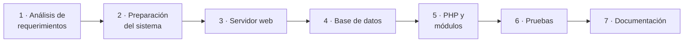

# 🛠️ Instalación de un servidor de aplicaciones web

<ExportPDF />

Este tema recorre el proceso completo de poner en marcha un servidor para aplicaciones web en Ubuntu Server: decidir qué hace falta, preparar el sistema, instalar el servidor web, la base de datos y PHP, comprobar que todo funciona y dejarlo documentado.



## 1. Análisis de requerimientos

Antes de instalar nada hay que saber **qué** va a ejecutar el servidor y **para cuántos** usuarios. El análisis de requerimientos recoge esas necesidades y las traduce en decisiones técnicas.

### Qué hay que averiguar

| Pregunta | Ejemplo de respuesta | Decisión que condiciona |
|:---------|:---------------------|:------------------------|
| ¿Qué aplicación se va a implantar? | Una tienda en línea con WordPress y WooCommerce. | Servidor web, lenguaje y base de datos. |
| ¿Qué requisitos publica la aplicación? | PHP 8.1 o superior, MySQL 8 o MariaDB 10.6, HTTPS. | Versiones del software. |
| ¿Cuántos usuarios habrá a la vez? | 50 de media, 300 en campañas. | CPU, memoria y ancho de banda. |
| ¿Cuántos datos se guardarán y cómo crecerán? | 5 GB de imágenes al año. | Almacenamiento. |
| ¿Qué datos se tratan? | Datos personales y pedidos. | Cifrado, copias, cumplimiento del RGPD. |
| ¿Qué disponibilidad se exige? | Puede pararse de madrugada para mantenimiento. | Redundancia, ventanas de actualización. |

### Requisitos funcionales y no funcionales

- Los **requisitos funcionales** describen lo que la aplicación debe hacer: «los clientes pueden pagar con tarjeta».
- Los **requisitos no funcionales** describen cómo debe hacerlo: «la página de producto carga en menos de 2 segundos», «las contraseñas se guardan cifradas».

El resultado del análisis es un **documento de requerimientos** que se revisa con las personas interesadas y en el que cada requisito se clasifica como esencial, deseable u opcional.

## 2. Preparación del sistema operativo

### Elegir el sistema

| Factor | Qué considerar |
|:-------|:---------------|
| Requisitos de la aplicación | Las aplicaciones .NET suelen requerir Windows Server; la mayoría de las aplicaciones PHP se documentan para Linux. |
| Conocimientos del equipo | Es más seguro un sistema que el equipo sabe administrar. |
| Coste y licencias | Ubuntu Server y Debian son libres; Windows Server requiere licencia. |
| Soporte | Las versiones LTS de Ubuntu tienen actualizaciones de seguridad durante cinco años. |

En el módulo se usa **Ubuntu Server LTS**.

### Pasos de preparación

1. **Actualizar el sistema** recién instalado:

   ```bash
   sudo apt update && sudo apt upgrade -y
   ```

2. **Dar un nombre y una dirección fija al servidor.** Un servidor no debe cambiar de IP. En Ubuntu la red se configura con Netplan, en `/etc/netplan/`:

   ```yaml
   network:
     version: 2
     ethernets:
       enp0s3:
         addresses: [192.168.1.50/24]
         routes:
           - to: default
             via: 192.168.1.1
         nameservers:
           addresses: [1.1.1.1, 8.8.8.8]
   ```

   ```bash
   sudo hostnamectl set-hostname servidor-web
   sudo netplan apply
   ```

3. **Crear un usuario administrador** distinto de `root`, que use `sudo`:

   ```bash
   sudo adduser admin
   sudo usermod -aG sudo admin
   ```

4. **Activar el cortafuegos** dejando pasar solo lo necesario:

   ```bash
   sudo ufw allow OpenSSH
   sudo ufw enable
   sudo ufw status
   ```

5. **Proteger el acceso por SSH.** En `/etc/ssh/sshd_config`, impedir el acceso directo de `root` (`PermitRootLogin no`) y, cuando estén configuradas las claves, desactivar las contraseñas (`PasswordAuthentication no`). Después, `sudo systemctl restart ssh`.

6. **Activar las actualizaciones de seguridad automáticas:**

   ```bash
   sudo apt install unattended-upgrades
   sudo dpkg-reconfigure --priority=low unattended-upgrades
   ```

## 3. Servidor web

### Apache

```bash
sudo apt install apache2
sudo systemctl status apache2        # comprobar que está en marcha
sudo systemctl enable apache2        # que arranque con el sistema
sudo ufw allow "Apache Full"         # abrir los puertos 80 y 443
```

Al abrir `http://IP-del-servidor` en un navegador debe aparecer la página de bienvenida de Apache.

| Archivo o directorio | Contenido |
|:---------------------|:----------|
| `/etc/apache2/apache2.conf` | Configuración general. |
| `/etc/apache2/ports.conf` | Puertos en los que escucha. |
| `/etc/apache2/sites-available/` | Un archivo por sitio (*virtual host*). |
| `/etc/apache2/sites-enabled/` | Enlaces a los sitios activos. |
| `/etc/apache2/mods-enabled/` | Módulos activos. |
| `/var/www/html/` | Carpeta pública por defecto. |
| `/var/log/apache2/` | Registros de accesos (`access.log`) y errores (`error.log`). |

#### Un sitio propio con un *virtual host*

```bash
sudo mkdir -p /var/www/intranet
sudo chown -R $USER:$USER /var/www/intranet
echo "<h1>Intranet</h1>" > /var/www/intranet/index.html
sudo nano /etc/apache2/sites-available/intranet.conf
```

```apache
<VirtualHost *:80>
    ServerName intranet.empresa.local
    DocumentRoot /var/www/intranet
    ErrorLog ${APACHE_LOG_DIR}/intranet_error.log
    CustomLog ${APACHE_LOG_DIR}/intranet_access.log combined
</VirtualHost>
```

```bash
sudo a2ensite intranet.conf       # activar el sitio
sudo apache2ctl configtest        # comprobar la sintaxis: debe decir «Syntax OK»
sudo systemctl reload apache2     # aplicar sin cortar las conexiones
```

| Orden | Para qué sirve |
|:------|:---------------|
| `a2ensite` / `a2dissite` | Activar o desactivar un sitio. |
| `a2enmod` / `a2dismod` | Activar o desactivar un módulo, por ejemplo `a2enmod rewrite`. |
| `apache2ctl configtest` | Comprobar la configuración antes de aplicarla. |
| `systemctl reload apache2` | Recargar la configuración. |

### Nginx

Nginx es la alternativa más extendida. Se instala igual (`sudo apt install nginx`), sus sitios están en `/etc/nginx/sites-available/` y su configuración tiene otra sintaxis:

```nginx
server {
    listen 80;
    server_name intranet.empresa.local;
    root /var/www/intranet;
    index index.php index.html;

    location ~ \.php$ {
        include snippets/fastcgi-php.conf;
        fastcgi_pass unix:/run/php/php8.3-fpm.sock;
    }
}
```

```bash
sudo ln -s /etc/nginx/sites-available/intranet /etc/nginx/sites-enabled/
sudo nginx -t                    # comprobar la configuración
sudo systemctl reload nginx
```

::: warning-box Apache y Nginx a la vez
Los dos usan el puerto 80. Si se instalan en la misma máquina, uno de los dos no arrancará hasta que se cambie su puerto o se detenga el otro.
:::

### HTTPS

Un servidor publicado en Internet debe servir sus páginas por HTTPS. Con un dominio real, **Certbot** obtiene un certificado gratuito de Let's Encrypt y configura Apache:

```bash
sudo apt install certbot python3-certbot-apache
sudo certbot --apache -d www.ejemplo.es
```

En un laboratorio sin dominio público, se puede activar el sitio SSL de ejemplo de Apache, que usa un certificado autofirmado: `sudo a2enmod ssl && sudo a2ensite default-ssl`.

## 4. Sistema gestor de bases de datos

En el módulo se usa **MariaDB**, compatible con MySQL e incluido en los repositorios de Ubuntu.

```bash
sudo apt install mariadb-server
sudo systemctl status mariadb
sudo mariadb-secure-installation
```

`mariadb-secure-installation` es un asistente que deja la instalación en un estado seguro: protege la cuenta `root`, elimina los usuarios anónimos y la base de datos de pruebas, e impide que `root` se conecte desde otras máquinas.

### Crear una base de datos y su usuario

Cada aplicación debe tener su propia base de datos y un usuario que **solo** tenga permisos sobre ella:

```bash
sudo mariadb
```

```sql
CREATE DATABASE intranet CHARACTER SET utf8mb4 COLLATE utf8mb4_unicode_ci;
CREATE USER 'intranet_user'@'localhost' IDENTIFIED BY 'una-contraseña-segura';
GRANT ALL PRIVILEGES ON intranet.* TO 'intranet_user'@'localhost';
FLUSH PRIVILEGES;
EXIT;
```

Comprueba que el usuario nuevo puede conectarse y ver su base de datos:

```bash
mariadb -u intranet_user -p -e "SHOW DATABASES;"
```

::: tip-box Principio de mínimo privilegio
Si la aplicación sufre un ataque, el atacante solo podrá hacer lo que permita el usuario de base de datos con el que se conecta. Por eso nunca se usa `root` para una aplicación.
:::

### Acceso remoto

Por defecto MariaDB solo escucha en `127.0.0.1`. Si la base de datos está en otra máquina distinta del servidor web, hay que cambiar `bind-address` en `/etc/mysql/mariadb.conf.d/50-server.cnf`, crear el usuario para la IP del servidor web (`'usuario'@'192.168.1.50'`) y abrir el puerto 3306 en el cortafuegos **solo** para esa IP:

```bash
sudo ufw allow from 192.168.1.50 to any port 3306
```

### Herramientas de gestión

- **Línea de órdenes:** el cliente `mariadb` (o `mysql`).
- **phpMyAdmin:** `sudo apt install phpmyadmin`. Conviene restringir su acceso, porque es un objetivo habitual de ataques.
- **Copias de seguridad:** `mariadb-dump -u root -p intranet > intranet.sql`.

## 5. Procesamiento de código: PHP

El servidor web solo sabe entregar archivos. Para ejecutar programas en el servidor necesita un intérprete. Con Apache hay dos formas de conectarlo con PHP:

| Forma | Cómo funciona | Cuándo usarla |
|:------|:--------------|:--------------|
| **Módulo de Apache** (`libapache2-mod-php`) | PHP se ejecuta dentro de los procesos de Apache. | Instalación sencilla, un único sitio. |
| **PHP-FPM** | PHP es un servicio aparte al que el servidor web pasa las peticiones. | Nginx, varios sitios con versiones o usuarios distintos, mejor rendimiento. |

### Instalación con el módulo de Apache

```bash
sudo apt install php libapache2-mod-php php-mysql
php -v
```

### Extensiones habituales

Las aplicaciones indican qué extensiones de PHP necesitan. Estas son las que piden casi todos los CMS:

| Extensión | Para qué |
|:----------|:---------|
| `php-mysql` | Conexión con MySQL/MariaDB (PDO y mysqli). |
| `php-xml` | Procesar XML: importaciones, *feeds*. |
| `php-mbstring` | Cadenas con caracteres multibyte (UTF-8). |
| `php-curl` | Peticiones a otros servidores: actualizaciones, APIs. |
| `php-gd` o `php-imagick` | Tratamiento de imágenes. |
| `php-zip` | Instalar plugins y temas comprimidos. |
| `php-intl` | Internacionalización. |

```bash
sudo apt install php-xml php-mbstring php-curl php-gd php-zip php-intl
sudo systemctl restart apache2
```

### Configuración del intérprete

La configuración de PHP está en `php.ini`. Con el módulo de Apache, en `/etc/php/8.3/apache2/php.ini` (la versión cambia según la distribución). Valores que se ajustan a menudo:

| Directiva | Qué controla | Valor orientativo |
|:----------|:-------------|:------------------|
| `upload_max_filesize` | Tamaño máximo de un archivo subido. | `64M` |
| `post_max_size` | Tamaño máximo de un envío de formulario. Debe ser mayor que el anterior. | `64M` |
| `memory_limit` | Memoria máxima por script. | `256M` |
| `max_execution_time` | Segundos máximos de ejecución. | `60` |
| `display_errors` | Mostrar errores en la página. | `On` en desarrollo, `Off` en producción |
| `date.timezone` | Zona horaria. | `Europe/Madrid` |

### Primera prueba

```bash
echo "<?php phpinfo(); ?>" | sudo tee /var/www/html/info.php
```

Al abrir `http://IP-del-servidor/info.php` debe aparecer la página de información de PHP, con la versión, el `php.ini` cargado y las extensiones activas.

::: danger-box Borra info.php al terminar
`phpinfo()` muestra rutas, versiones y configuración que facilitan un ataque. Es una página de prueba: `sudo rm /var/www/html/info.php`.
:::

## 6. Comprobación del sistema

Una instalación no está terminada hasta que se ha comprobado que cumple los requerimientos. Las pruebas se organizan de lo más pequeño a lo más general:

| Tipo de prueba | Qué comprueba | Ejemplo |
|:---------------|:--------------|:--------|
| **Unidad** | Una pieza aislada. | Una función PHP devuelve el resultado esperado. |
| **Integración** | Que las piezas se comunican. | PHP se conecta a la base de datos con el usuario de la aplicación. |
| **Sistema** | El conjunto, en condiciones reales. | La aplicación funciona por HTTPS desde otro equipo de la red. |
| **Aceptación** | Que cumple lo que pidió el cliente. | Un usuario de la empresa completa una compra de prueba. |

### Comprobaciones básicas tras la instalación

```bash
systemctl status apache2 mariadb        # servicios en marcha
ss -tlnp | grep -E ':80|:443|:3306'     # puertos a la escucha
curl -I http://localhost                # el servidor responde (código 200)
sudo tail -f /var/log/apache2/error.log # errores mientras se prueba
```

### Herramientas

| Finalidad | Herramientas |
|:----------|:-------------|
| Pruebas automatizadas de código | PHPUnit |
| Pruebas de la interfaz en el navegador | Selenium, Playwright |
| Pruebas de carga | Apache Bench (`ab`), JMeter, k6 |
| Pruebas de seguridad | OWASP ZAP, Nikto |
| Monitorización | Nagios, Zabbix, Prometheus con Grafana |

Ejemplo de prueba de carga con Apache Bench, que viene con el paquete `apache2-utils`: 1000 peticiones, 50 a la vez.

```bash
ab -n 1000 -c 50 http://localhost/
```

## 7. Instalación integrada con contenedores

Instalar cada servicio a mano enseña cómo funciona, pero es lento de repetir. Las **plataformas integradas** permiten levantar el entorno completo de una vez:

- **XAMPP, AMPPS, Laragon:** paquetes «todo en uno» para el equipo del desarrollador. Se ven en [Herramientas y puesta en marcha](./2-herramientas-entorno).
- **Docker y Docker Compose:** cada servicio va en un contenedor, y un archivo describe el entorno completo. El mismo archivo sirve en el portátil y en el servidor.

Ejemplo de entorno con servidor web, PHP y MariaDB:

```yaml
# docker-compose.yml
services:
  web:
    image: php:8.3-apache
    ports:
      - "8080:80"
    volumes:
      - ./src:/var/www/html
    depends_on:
      - db
  db:
    image: mariadb:11
    environment:
      MARIADB_ROOT_PASSWORD: cambiar-esta-clave
      MARIADB_DATABASE: intranet
      MARIADB_USER: intranet_user
      MARIADB_PASSWORD: cambiar-esta-clave
    volumes:
      - datos:/var/lib/mysql
volumes:
  datos:
```

```bash
docker compose up -d      # levantar el entorno
docker compose ps         # ver los contenedores
docker compose down       # pararlo
```

::: info-box Integración y despliegue continuos
En los equipos de desarrollo, herramientas como GitHub Actions o GitLab CI construyen, prueban y despliegan la aplicación automáticamente cada vez que se sube un cambio al repositorio. Este mismo sitio web se publica así.
:::

## 8. Documentación de la instalación

La documentación permite repetir la instalación, resolver problemas y que otra persona se haga cargo del servidor. Debe recoger:

1. **Requisitos del sistema:** hardware, sistema operativo y versiones de cada componente.
2. **Procedimiento de instalación:** las órdenes ejecutadas, en orden, con lo que hace cada una.
3. **Configuración:** los archivos modificados y los valores cambiados.
4. **Credenciales:** dónde están guardadas, nunca las contraseñas en el propio documento.
5. **Comprobaciones:** cómo verificar que todo funciona.
6. **Problemas encontrados** y cómo se resolvieron.
7. **Mantenimiento:** cómo se actualiza y cómo se hacen y restauran las copias de seguridad.

::: tip-box Documenta mientras instalas
Si guardas la documentación en Markdown dentro de un repositorio Git, queda versionada junto con los archivos de configuración. Así se sabe qué cambió en el servidor y cuándo.
:::

::: note-box Fuente
Tema elaborado a partir de los contenidos del aula de IAW del CEEDCV (Sergio Pérez Rubio, curso 2025-2026). Ver [Créditos y fuentes](/general/contenidos/4-creditos).
:::

---

**Siguiente paso:** [Prácticas de la unidad →](../ejercicios/)
