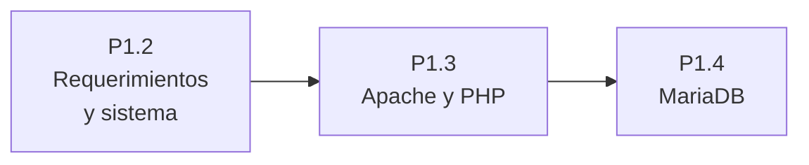

# 🧪 Prácticas de UP1

| Práctica | Qué se hace | CE |
|:---------|:------------|:--:|
| [P1.1 Control de versiones con Git y GitHub](./1-git-github) | Llevar con Git la documentación de un servidor y colaborar en GitHub. | 1b, 1i |
| [P1.2 Análisis de requerimientos y preparación del sistema](./2-requerimientos-sistema) | Analizar lo que necesita una tienda en línea y preparar Ubuntu Server. | 1a, 1b, 1g, 1i |
| [P1.3 Instalación de Apache y PHP en Ubuntu](./3-apache-ubuntu) | Instalar el servidor web, publicar un sitio y añadir PHP. | 1c, 1e, 1g, 1i |
| [P1.4 Instalación de MariaDB en Ubuntu](./4-mariadb-ubuntu) | Completar el servidor LAMP con la base de datos y conectarla con PHP. | 1c, 1f, 1g, 1i |
| [P1.5 Entorno integrado con Docker Compose](./5-docker-compose) | Levantar el mismo entorno con contenedores y comparar el procesamiento en cliente y servidor. | 1d, 1h, 1i |

Las prácticas P1.2, P1.3 y P1.4 se hacen sobre la misma máquina virtual: al final tendrás un servidor LAMP completo y documentado.

## Antes de empezar

Además de la máquina virtual, deja listo el entorno local siguiendo [Herramientas y puesta en marcha](../contenidos/2-herramientas-entorno): lo necesitarás desde la primera práctica de la [UP2](/up2/ejercicios/).

- [ ] Stack local (AMPPS o XAMPP) instalado.
- [ ] Servicios Apache y MySQL arrancados.
- [ ] `http://localhost` responde en el navegador.
- [ ] Visual Studio Code instalado con la extensión PHP Intelephense.

## Cómo se evalúan

Cada práctica tiene su rúbrica, con un elemento evaluable por cada criterio de evaluación que recoge. Todas usan la [escala de niveles 0–4](/general/contenidos/3-evaluacion) del módulo.
