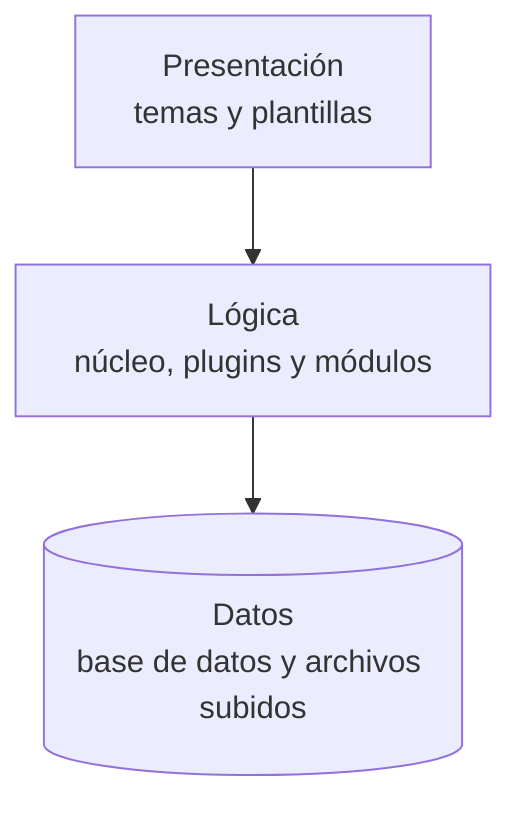
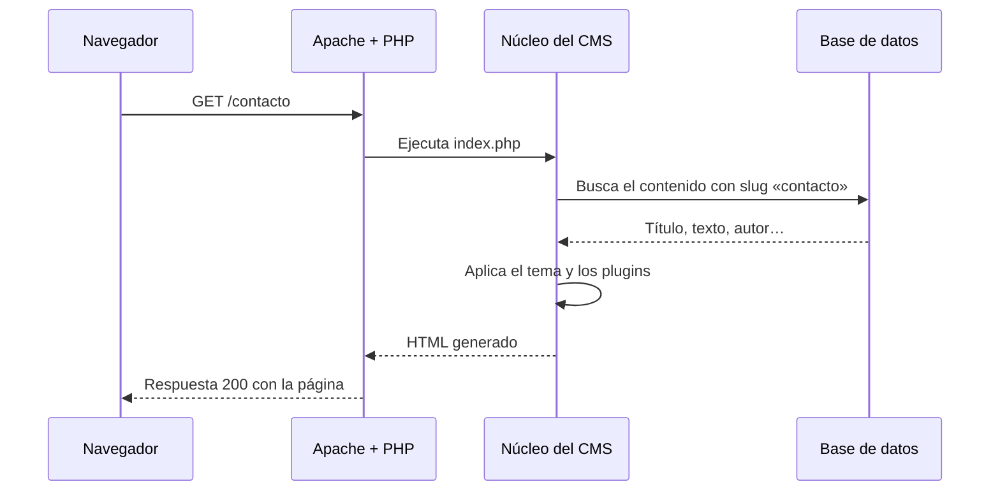
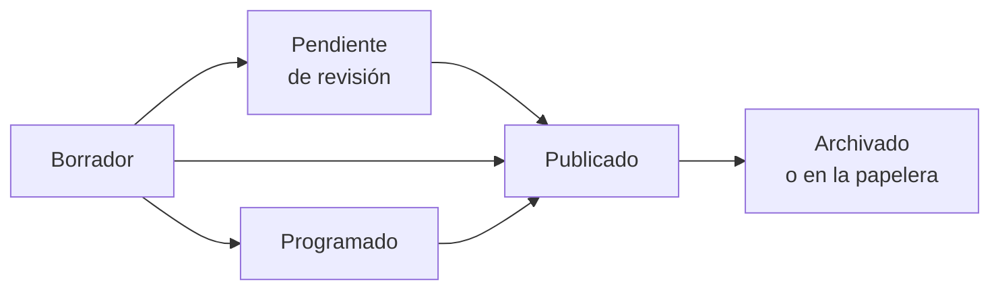

# 📰 Gestores de contenidos: tipos, instalación y puesta en marcha

<ExportPDF />

Un **gestor de contenidos** (CMS, *Content Management System*) es una aplicación web que permite crear, organizar y publicar contenidos desde un panel de administración, sin escribir código. Separa el **contenido**, que se guarda en una base de datos, de la **presentación**, que decide un tema o plantilla. Así, quien redacta no necesita saber HTML y quien diseña puede cambiar el aspecto de todo el sitio sin tocar los textos.

## Tipos de gestores de contenidos

Los CMS se clasifican por el tipo de sitio que permiten gestionar:

| Tipo | Para qué sirve | Ejemplos |
|:-----|:---------------|:---------|
| **Portal o CMS generalista** | Sitios corporativos e institucionales con muchas secciones y perfiles de usuario. | WordPress, Joomla, Drupal |
| **Blog** | Publicación de artículos ordenados por fecha, con categorías y comentarios. | WordPress, Ghost |
| **Wiki** | Documentación escrita en colaboración, con historial de cambios de cada página. | MediaWiki, DokuWiki, BookStack |
| **Plataforma de aprendizaje (LMS)** | Cursos, actividades, calificaciones y seguimiento del alumnado. | Moodle, Chamilo |
| **Foro** | Debates organizados en temas y mensajes. | phpBB, Discourse |
| **Comercio electrónico** | Catálogo, carrito, pagos y pedidos. | WooCommerce (sobre WordPress), PrestaShop, Magento |
| **Groupware o trabajo colaborativo** | Archivos compartidos, calendario, tareas y edición conjunta. | Nextcloud, Odoo |

::: info-box Gestores de contenidos para la intranet de una empresa
Para una intranet se buscan CMS libres que se puedan instalar en un servidor propio, con gestión de usuarios y permisos, y que no dependan de un proveedor externo. WordPress, Drupal, MediaWiki o Nextcloud cumplen estas condiciones.
:::

## Licencias de uso

La licencia de un CMS dice qué se puede hacer con él: usarlo, modificarlo, redistribuirlo o venderlo. Es lo primero que hay que comprobar antes de implantarlo en una empresa.

| Licencia | Qué permite | Condición principal | Ejemplos |
|:---------|:------------|:--------------------|:---------|
| **GPL** (*GNU General Public License*) | Usar, estudiar, modificar y redistribuir. | Las versiones modificadas que se distribuyan deben llevar también la GPL (*copyleft*). | WordPress (GPLv2 o posterior), Joomla, Drupal, Moodle (GPLv3) |
| **LGPL** | Como la GPL, pero permite enlazar la biblioteca desde programas con otra licencia. | Las modificaciones de la propia biblioteca siguen en LGPL. | Bibliotecas de software |
| **MIT y BSD** | Casi cualquier uso, incluso en software propietario. | Mantener el aviso de copyright. | Ghost (MIT) |
| **Apache 2.0** | Como MIT, con una concesión expresa de patentes. | Mantener avisos y documentar los cambios. | Muchos proyectos de la Apache Software Foundation |
| **Propietaria** | Lo que diga el contrato: normalmente solo el uso. | Pago de licencia o suscripción; sin acceso al código. | Wix, Squarespace |

::: tip-box Cómo elegir según la licencia
- Si la empresa va a modificar el CMS para uso interno, la GPL no le obliga a publicar nada: la obligación nace solo al **distribuir** el software modificado.
- Los temas y plugins pueden tener licencias distintas al CMS. Un plugin «premium» puede exigir una suscripción para recibir actualizaciones.
- Un CMS propietario en la nube es rápido de poner en marcha, pero los datos quedan en manos del proveedor y es difícil migrar.
:::

## Requisitos de funcionamiento

Casi todos los CMS libres funcionan sobre una pila LAMP: un servidor web, una base de datos y un lenguaje de servidor.

| Componente | Opciones habituales | Qué comprobar |
|:-----------|:--------------------|:--------------|
| Servidor web | Apache, Nginx, LiteSpeed | Si el CMS necesita `mod_rewrite` para las URL amigables. |
| Base de datos | MySQL, MariaDB, PostgreSQL | Versión mínima y juego de caracteres `utf8mb4`. |
| Lenguaje | PHP (la mayoría), Python, Node.js | Versión mínima y extensiones necesarias. |
| Hardware | CPU, memoria, disco | Depende del tráfico y del contenido multimedia. |

Cada proyecto publica sus requisitos actualizados: [WordPress](https://wordpress.org/about/requirements/), [Joomla](https://manual.joomla.org/docs/next/get-started/technical-requirements/), [Drupal](https://www.drupal.org/docs/getting-started/system-requirements), [Moodle](https://moodledev.io/general/releases).

## Comparativa de los CMS que se trabajan en el módulo

| | WordPress | Joomla | Drupal | Moodle |
|:--|:----------|:-------|:-------|:-------|
| **Tipo** | Generalista y blog | Generalista | Generalista para proyectos grandes | Plataforma de aprendizaje |
| **Licencia** | GPLv2 o posterior | GPLv2 o posterior | GPLv2 o posterior | GPLv3 o posterior |
| **Curva de aprendizaje** | Baja | Media | Alta | Media |
| **Extensiones** | Plugins y temas: el mayor catálogo | Componentes, módulos, plugins y plantillas | Módulos y temas | Plugins de actividad, bloques y temas |
| **Usuarios y permisos** | Roles predefinidos; se amplían con plugins | Grupos y niveles de acceso muy detallados | Roles y permisos muy detallados | Roles por contexto: sitio, curso, actividad |
| **Multidioma** | Con plugins | Integrado | Integrado | Paquetes de idioma integrados |
| **Uso típico** | Webs corporativas, blogs, tiendas | Portales institucionales | Administraciones, universidades, medios | Centros educativos, formación en empresas |

## Terminología

| Término | Significado |
|:--------|:------------|
| **Panel de administración** (*backend*) | Zona privada desde la que se gestiona el sitio. |
| **Parte pública** (*frontend*) | Lo que ven los visitantes. |
| **Entrada** (*post*) | Contenido fechado que aparece en orden cronológico: noticias, artículos. |
| **Página** | Contenido estático y jerárquico: «Quiénes somos», «Contacto». |
| **Categoría** | Clasificación jerárquica de los contenidos. |
| **Etiqueta** (*tag*) | Palabra clave libre, sin jerarquía, para relacionar contenidos. |
| **Tema o plantilla** | Conjunto de archivos que define el aspecto del sitio. |
| **Plugin, módulo o extensión** | Componente que añade una funcionalidad. |
| **Widget o bloque** | Elemento que se coloca en una zona del tema: barra lateral, pie. |
| **Slug** | La parte legible de la URL de un contenido: `/contacto`. |
| **Enlace permanente** (*permalink*) | La URL definitiva de un contenido. |
| **Biblioteca de medios** | Lugar donde se guardan las imágenes, vídeos y documentos subidos. |
| **Rol** | Conjunto de permisos que se asigna a un usuario. |

## Tipos de instalación

| Según dónde | Ventajas | Inconvenientes |
|:------------|:---------|:---------------|
| **Local** (en el propio equipo, con XAMPP, AMPPS o una máquina virtual) | Gratuita, sin riesgos, ideal para aprender y probar. | Nadie más puede verla. |
| **Remota** (en un alojamiento o un servidor en Internet) | Accesible desde cualquier lugar; es la que se publica. | Coste, y exige cuidar la seguridad desde el primer momento. |

| Según cómo | Cómo se hace |
|:-----------|:-------------|
| **Con instalador automático** | Paneles como Softaculous (en AMPPS o en muchos alojamientos) instalan el CMS y crean la base de datos en un par de pantallas. |
| **Manual** | Se crea la base de datos, se copian los archivos al servidor y se ejecuta el asistente web del CMS. Da control sobre cada paso. |
| **Con contenedores** | Se usa la imagen oficial del CMS en Docker, con su base de datos en otro contenedor. |
| **Desde la línea de órdenes** | Herramientas como WP-CLI (`wp core install`) permiten automatizar la instalación. |

## Instalación manual de WordPress en un servidor LAMP

Este es el procedimiento completo sobre el servidor Ubuntu de la [UP1](/up1/contenidos/5-instalacion-servidores), con Apache, MariaDB y PHP ya instalados.

### 1. Crear la base de datos y su usuario

```sql
CREATE DATABASE wordpress CHARACTER SET utf8mb4 COLLATE utf8mb4_unicode_ci;
CREATE USER 'wp_user'@'localhost' IDENTIFIED BY 'una-contraseña-segura';
GRANT ALL PRIVILEGES ON wordpress.* TO 'wp_user'@'localhost';
FLUSH PRIVILEGES;
```

Con phpMyAdmin se hace lo mismo desde la pestaña **Bases de datos** (crear) y **Cuentas de usuario** (crear el usuario y darle privilegios solo sobre esa base de datos).

### 2. Descargar WordPress y copiarlo al servidor

```bash
cd /tmp
wget https://wordpress.org/latest.tar.gz
tar -xzf latest.tar.gz
sudo mv wordpress /var/www/wordpress
sudo chown -R www-data:www-data /var/www/wordpress
```

`www-data` es el usuario con el que se ejecuta Apache. Al hacerlo propietario de los archivos, WordPress puede instalar plugins, temas y actualizaciones.

### 3. Crear el sitio en Apache

```apache
<VirtualHost *:80>
    ServerName wordpress.empresa.local
    DocumentRoot /var/www/wordpress
    <Directory /var/www/wordpress>
        AllowOverride All
    </Directory>
    ErrorLog ${APACHE_LOG_DIR}/wordpress_error.log
    CustomLog ${APACHE_LOG_DIR}/wordpress_access.log combined
</VirtualHost>
```

```bash
sudo a2ensite wordpress.conf
sudo a2enmod rewrite          # necesario para los enlaces permanentes
sudo systemctl reload apache2
```

`AllowOverride All` permite que WordPress use su archivo `.htaccess` para las URL amigables.

### 4. Ejecutar el asistente web

Al abrir `http://wordpress.empresa.local`, el asistente pide:

1. El idioma.
2. Los datos de la base de datos: nombre, usuario, contraseña, servidor (`localhost`) y **prefijo de tablas**. Con ellos crea el archivo `wp-config.php`.
3. El título del sitio, el usuario administrador, su contraseña y su correo.

::: tip-box Cambia el prefijo de las tablas
Por defecto las tablas se llaman `wp_posts`, `wp_users`… Usar otro prefijo (`intra_`) no es una medida de seguridad por sí sola, pero dificulta los ataques automatizados que dan por hecho el nombre de las tablas, y permite tener varias instalaciones en la misma base de datos.
:::

## Estructura de un CMS

Un CMS se compone de tres capas:



En WordPress, por ejemplo:

| Ubicación | Contenido |
|:----------|:----------|
| `wp-admin/` | El panel de administración. |
| `wp-includes/` | El núcleo: funciones y clases de WordPress. |
| `wp-content/themes/` | Los temas instalados. |
| `wp-content/plugins/` | Los plugins instalados. |
| `wp-content/uploads/` | Los archivos subidos a la biblioteca de medios, por año y mes. |
| `wp-config.php` | Datos de conexión a la base de datos, claves de seguridad y opciones globales. |
| `.htaccess` | Reglas de Apache para las URL amigables. |

Los contenidos, usuarios y ajustes van en la base de datos: `wp_posts` (entradas, páginas y revisiones), `wp_users`, `wp_options` (ajustes del sitio), `wp_terms` (categorías y etiquetas), entre otras.

::: warning-box No modifiques el núcleo
Los archivos de `wp-admin` y `wp-includes` se sustituyen en cada actualización. Todo lo que se personalice va en temas, temas hijo o plugins, dentro de `wp-content`. Se ve en la [UP4](/up4/).
:::

## Cómo funciona un CMS

Cuando un visitante pide una página:



### Ciclo de vida de un contenido

Un contenido pasa por varios estados, y cada rol puede llevarlo hasta uno u otro:



## Creación de contenidos

- **Entradas y páginas.** El editor de bloques de WordPress (Gutenberg) compone el contenido con bloques: párrafo, imagen, galería, tabla, botón, columnas… Cada contenido guarda **revisiones**, de modo que se puede volver a una versión anterior.
- **Categorías y etiquetas.** Las categorías organizan el sitio en secciones; las etiquetas relacionan contenidos de distintas secciones. Una entrada debe tener al menos una categoría.
- **Multimedia.** Las imágenes se suben a la biblioteca de medios, que genera varios tamaños. Conviene rellenar siempre el **texto alternativo** para la accesibilidad y reducir el tamaño de los archivos antes de subirlos.

## Personalización de la interfaz

- **Temas.** Se instalan desde el repositorio oficial o subiendo un `.zip`. Un tema de bloques se personaliza con el **editor del sitio** (colores, tipografías, cabecera, pie); un tema clásico, con el **personalizador**.
- **Identidad del sitio.** Título, descripción, logotipo e icono del sitio (*favicon*).
- **Diseño y usabilidad.** Un buen tema es adaptable a móviles (*responsive*), accesible y ligero. Las herramientas de arrastrar y soltar, como el propio editor de bloques o maquetadores como Elementor, permiten componer páginas sin programar, a costa de añadir peso.

### Internacionalización

Los CMS separan los textos de la interfaz en archivos de traducción, por lo que el panel se puede usar en muchos idiomas. Para que el **contenido** esté en varios idiomas hace falta un plugin en WordPress (Polylang, WPML) o activar la función multidioma que ya traen Joomla y Drupal.

## Adaptación de menús

Los menús se crean en **Apariencia → Menús** (temas clásicos) o en el **editor del sitio** con el bloque de navegación (temas de bloques).

1. Planifica la estructura antes de crearla: qué secciones hay y cómo se agrupan.
2. Crea el menú y añade páginas, categorías o enlaces personalizados.
3. Arrastra los elementos para crear subniveles.
4. Asigna el menú a una ubicación del tema: cabecera, pie…

::: tip-box Buenas prácticas de usabilidad
- No más de siete elementos en el primer nivel.
- No más de tres niveles de profundidad.
- Nombres cortos y que el usuario entienda: «Contacto» mejor que «Formulario de comunicación».
- Que el menú funcione en móviles.
:::

## Mecanismos de seguridad integrados

| Medida | Cómo se aplica |
|:-------|:---------------|
| Contraseñas fuertes | WordPress mide la fortaleza de cada contraseña y propone una aleatoria. |
| Usuario administrador propio | No usar `admin` como nombre de usuario. |
| Roles y permisos | Dar a cada persona el rol mínimo que necesite. Se ve en la [UP3](/up3/). |
| Actualizaciones | Mantener al día el núcleo, los temas y los plugins. |
| HTTPS | Servir el sitio y el panel siempre cifrados. |
| Claves de seguridad | Las constantes `AUTH_KEY`, `SECURE_AUTH_KEY`… de `wp-config.php` protegen las cookies de sesión. |
| Desactivar el editor de archivos | `define('DISALLOW_FILE_EDIT', true);` en `wp-config.php` impide editar el código de temas y plugins desde el panel. |
| Plugins de seguridad | Wordfence o Solid Security añaden cortafuegos de aplicación, límite de intentos de acceso y segundo factor de autenticación. |

## Verificación del funcionamiento y del rendimiento

- **Funcionamiento:** recorrer la parte pública y el panel, probar los formularios, los enlaces del menú, la búsqueda y la visualización en móvil. La herramienta **Salud del sitio** de WordPress (en **Herramientas**) revisa la configuración del servidor y avisa de problemas.
- **Rendimiento:** medir el tiempo de carga con las herramientas de desarrollador del navegador, PageSpeed Insights o GTmetrix.
- **Optimización:** caché de páginas, imágenes optimizadas y en formato WebP, el menor número posible de plugins y, en sitios con mucho tráfico, una red de distribución de contenidos (CDN).

## Publicación

Llevar un sitio del entorno de pruebas a producción supone:

1. **Preparar el servidor de destino**: dominio, alojamiento, HTTPS.
2. **Migrar archivos y base de datos.** Si cambia la dirección del sitio, hay que actualizar las URL guardadas en la base de datos, con un plugin de migración o con `wp search-replace`.
3. **Revisar los ajustes de producción**: errores ocultos, indexación en buscadores activada, copias de seguridad programadas.
4. **Comprobar** de nuevo todo el sitio en su dirección definitiva.
5. **Vigilar** después del lanzamiento: registros de errores, rendimiento y comentarios de los usuarios.

## Actualizaciones y mantenimiento

| Tipo de actualización | Ejemplo | Recomendación |
|:----------------------|:--------|:--------------|
| De seguridad o menor | 6.6.1 → 6.6.2 | Aplicar cuanto antes. WordPress las instala solo por defecto. |
| Mayor | 6.6 → 6.7 | Probar antes en una copia del sitio y hacer copia de seguridad. |
| De plugins y temas | Cualquier versión nueva | Revisar el registro de cambios y que sean compatibles con la versión del núcleo. |

## Documentación de la instalación y de la adaptación

Igual que con el servidor, la instalación de un CMS se documenta: requisitos, procedimiento, configuración, plugins y temas instalados con sus versiones, cambios realizados, copias de seguridad y problemas resueltos. Para el usuario final se redacta además un **manual de uso**, como el que se elabora en el [proyecto del portal interno](../ejercicios/).

::: note-box Fuente
Tema elaborado a partir de los contenidos del aula de IAW del CEEDCV (Sergio Pérez Rubio, curso 2025-2026). Ver [Créditos y fuentes](/general/contenidos/4-creditos).
:::

---

**Siguiente paso:** [Prácticas de la unidad →](../ejercicios/)
