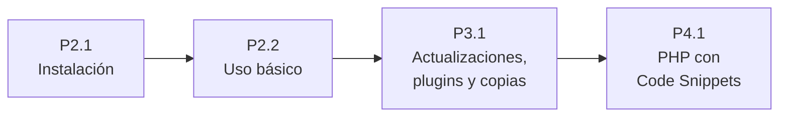

# 🧪 Prácticas de UP2

## El proyecto: un portal interno con WordPress

### El encargo

Una empresa quiere mejorar la comunicación entre sus empleados y el administrador de sistemas. Para ello decide utilizar WordPress como una aplicación web **interna**, donde se puedan publicar avisos, comunicar incidencias y consultar documentación básica.

Tú eres la persona encargada de instalar y configurar WordPress para cumplir este objetivo.

::: accent-box purple 🎯 Objetivo general
Instalar y configurar un sitio web con WordPress, adaptándolo como una plataforma sencilla de comunicación interna.
:::

### Cómo se trabaja

El encargo se resuelve con una serie de prácticas encadenadas, repartidas entre tres unidades. Cada práctica parte del sitio tal como quedó en la anterior.

| Práctica | Unidad | Punto del manual |
|:---------|:------:|:-----------------|
| [P2.1 Instalación de WordPress en AMPPS](./1-instalacion-wordpress) | UP2 | 1. Instalación de WordPress sobre AMPPS en Windows |
| [P2.2 Uso básico de WordPress](./2-uso-basico-wordpress) | UP2 | 2. Aspecto general del portal web |
| [P3.1 Actualizaciones, plugins, copias de seguridad e importación](/up3/ejercicios/1-actualizaciones-copias) | UP3 | 3. Parches y actualizaciones · 4. Gestión de plugins · 5. Copias de seguridad · 6. Exportación e importación de contenido |
| [P4.1 PHP en WordPress con Code Snippets](/up4/ejercicios/1-code-snippets) | UP4 | 7. Instalación y uso del plugin Code Snippets |

### El entregable del proyecto: un manual de usuario

Con todo lo aprendido se elabora un único **manual de usuario**, que va creciendo con cada práctica. Cada práctica indica qué punto o puntos del manual hay que añadir.

::: tip-box Un manual no es la memoria de una práctica
El manual tiene que poder usarlo, de forma autónoma, alguien que no conozca WordPress. Eso significa explicar qué se hace, para qué y dónde está cada opción, con capturas que ayuden a seguir los pasos. Un documento breve que solo demuestra que has hecho la práctica no es un manual.
:::

### Cómo se evalúa

Cada práctica tiene su rúbrica, con un elemento evaluable por cada criterio de evaluación que recoge. Todas usan la [escala de niveles 0–4](/general/contenidos/3-evaluacion) del módulo. El manual es la evidencia con la que se valoran los niveles 3 (justificado) y 4 (bien comunicado).

## Otras prácticas de la unidad

Estas prácticas no forman parte del proyecto del portal. Cada una instala un gestor de contenidos en un entorno distinto.

| Práctica | Qué se hace | CE |
|:---------|:------------|:--:|
| [P2.3 WordPress en un alojamiento remoto](./3-wordpress-remoto) | Publicar WordPress en Internet con una instalación manual. | 2c, 2f, 2g, 2h |
| [P2.4 WordPress en un servidor LAMP](./4-wordpress-lamp) | Instalar WordPress a mano sobre el servidor Ubuntu de la UP1. | 2c, 2e, 2f, 2g |
| [P2.5 Instalación de Moodle](./5-moodle) | Poner en marcha una plataforma de aprendizaje. | 2b, 2c, 2e, 2g |
| [P2.6 Joomla en un servidor remoto](./6-joomla-remoto) | Instalar Joomla y comparar gestores de contenidos. | 2a, 2c, 2d, 2h |
