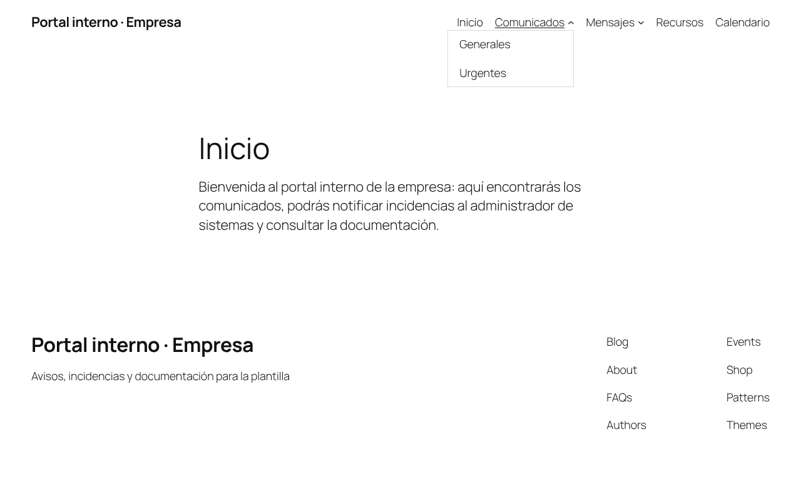

# ✅ Solución P2.2 — Uso básico de WordPress

<ExportPDF />

::: info-box Cómo usar esta solución
Es **una** solución de referencia: otras configuraciones son válidas si funcionan y se justifican. Enunciado: [P2.2 Uso básico de WordPress](../ejercicios/2-uso-basico-wordpress).
:::

- **Unidad:** UP2 · RA2 · CE 2e, 2g, 2h. Proyecto del portal interno.
- **Punto de partida:** el sitio de la P2.1 (`http://localhost/wp_ana`).
- **Entrega del alumnado:** punto 2 del manual de usuario.
- **Archivos de la solución** (probados con WordPress 7.1.4 y el tema Twenty Twenty-Five):
  - <a :href="withBase('/soluciones/up2/p2.2-uso-basico-wordpress/estructura-portal.sh')" download><code>estructura-portal.sh</code></a>: crea con WP-CLI los ajustes, las páginas, la portada y el menú de referencia. Sirve para preparar una demostración o comparar con el sitio de un alumno.

::: warning Menús en los temas de bloques
WordPress instala por defecto un **tema de bloques** (Twenty Twenty-Five). En estos temas **no existe Apariencia → Menús**: el menú se edita en **Apariencia → Editor → Navegación** (o en el bloque *Navegación* de la cabecera). Los apuntes antiguos y muchos tutoriales hablan de *Apariencia → Menús*, que solo aparece con temas clásicos (Astra, GeneratePress, Twenty Twenty-One…). Las dos vías son válidas; la solución recoge ambas.
:::

---

## 1. Ajustes generales

**Ajustes → Generales**:

| Ajuste | Valor de referencia | Efecto (nivel 3) | Por qué, para un portal interno (nivel 4) |
|:-------|:--------------------|:-----------------|:------------------------------------------|
| Título del sitio | `Portal interno · Empresa` | Cabecera del tema, pestaña del navegador, correos que envía WordPress. | Que el empleado reconozca dónde está; sustituye al `wp_ana` de la instalación. |
| Descripción corta | `Avisos, incidencias y documentación para la plantilla` | Lema bajo el título (según el tema) y descripción en buscadores. | Resume para qué sirve el portal. |
| Zona horaria | **Madrid** (no `UTC+1`) | Fecha y hora de publicación de entradas, programación de contenidos, registros. | Los comunicados urgentes deben llevar la hora real. Con «Madrid» se aplica el horario de verano; con `UTC+1` fijo, no. |
| Formato de fecha / hora | `j \d\e F \d\e Y` / `H:i` | Cómo se muestran las fechas. | Formato habitual en España (9 de noviembre de 2026, 20:15). |
| La semana comienza el | Lunes | Calendarios. | Enlaza con la página **Calendario**. |
| Idioma del sitio | Español | Textos del panel y del tema. | |

Además, **Ajustes → Lectura**: «Tu página de inicio muestra» → **Una página estática** → Portada: **Inicio**. Sin esto, la portada es la lista de entradas y la página «Inicio» queda como una página más.

## 2. Logo y *favicon*

Con un **tema de bloques** (Twenty Twenty-Five):

- **Logo:** **Apariencia → Editor → Patrones → Partes de la plantilla → Header** → seleccionar el bloque *Título del sitio* → añadir delante un bloque **Logo del sitio** → subir la imagen → **Guardar**.
- **Favicon (icono del sitio):** **Ajustes → Generales → Icono del sitio** (en versiones anteriores estaba en el Personalizador). Imagen cuadrada de al menos **512 × 512 px**.

Con un **tema clásico**: **Apariencia → Personalizar → Identidad del sitio** (logo e icono en la misma pantalla).

Comprobación: el logo en la cabecera y el icono en la pestaña del navegador (recargar con `Ctrl+F5`, el *favicon* se cachea mucho).

Requisitos de las imágenes: logo en PNG o SVG con fondo transparente y altura moderada (≈ 60–100 px visibles); *favicon* cuadrado y reconocible en 16 px. Un logo inventado o generado para la práctica es suficiente; no usar logos de empresas reales.

## 3. Páginas y menú

### Páginas

**Páginas → Añadir nueva página**, una por cada elemento. Las subpáginas se crean con **Atributos de página → Superior** (panel derecho del editor) apuntando a su página padre; **Orden** fija la posición.

| Página | Superior | Contenido mínimo | Slug resultante |
|:-------|:---------|:-----------------|:----------------|
| Inicio | — | Presentación del portal interno | `/inicio/` (usada como portada) |
| Comunicados | — | Texto breve de la sección | `/comunicados/` |
| Generales | Comunicados | Información general para empleados | `/comunicados/generales/` |
| Urgentes | Comunicados | Comunicados urgentes | `/comunicados/urgentes/` |
| Mensajes | — | Comunicación bidireccional | `/mensajes/` |
| Incidencias resueltas | Mensajes | — | `/mensajes/incidencias-resueltas/` |
| Notificar incidencia | Mensajes | — | `/mensajes/notificar-incidencia/` |
| Recursos | — | Repositorio de archivos | `/recursos/` |
| Calendario | — | Eventos y fechas importantes | `/calendario/` |

Todas en estado **Publicado** (no «Borrador» ni «Privado»). Conviene borrar o pasar a borrador la «Página de ejemplo».

Para que las URL sean como las de la tabla: **Ajustes → Enlaces permanentes → Nombre de la entrada → Guardar**. En AMPPS funciona sin más; si diera 404, falta `mod_rewrite` o el `.htaccess` (se ve en la P2.4).

### Menú con un tema de bloques

**Apariencia → Editor → Navegación** (o la cabecera → bloque *Navegación* → **Editar**):

1. Crear un menú nuevo: «Menú principal».
2. **Añadir enlace** → buscar la página **Inicio**, **Comunicados**, **Mensajes**, **Recursos**, **Calendario**.
3. Para el segundo nivel: seleccionar **Comunicados** → icono **Añadir submenú** → enlazar **Generales** y **Urgentes**. Igual en **Mensajes** con **Incidencias resueltas** y **Notificar incidencia**.
4. Ordenar arrastrando en la vista de lista y **Guardar**.

### Menú con un tema clásico

**Apariencia → Menús → crea un nuevo menú** → «Menú principal» → marcar las páginas → **Añadir al menú** → arrastrar las subpáginas **un poco a la derecha** debajo de su padre (quedan como «subelemento») → **Ubicación del menú: Menú principal / Primario** → **Guardar menú**.

### Relación entre páginas y menú (nivel 3)

- La **página** es el contenido; el **menú** es solo una lista de enlaces. Que «Urgentes» sea hija de «Comunicados» (atributo *Superior*) afecta a su URL y a la jerarquía; que aparezca debajo en el menú es una decisión **aparte**. Hay que hacer las dos cosas.
- Por eso borrar una página no la quita automáticamente de un menú creado a mano y crear una página no la añade.
- Organización elegida: las secciones principales en el primer nivel (lo que un empleado busca a diario) y el detalle en desplegables; máximo dos niveles para que se pueda usar en el móvil.

## 4. Tema

Cualquier tema es válido si se **justifica** y se **adapta**. Dos opciones de referencia:

| Opción | Por qué para un portal interno | Adaptaciones mínimas |
|:-------|:-------------------------------|:--------------------|
| **Twenty Twenty-Five** (el que trae WordPress) | Mantenido por WordPress, ligero, accesible, sin plugins obligatorios ni versiones «pro». | **Estilos**: paleta corporativa y tipografía; cabecera con logo y menú; **pie**: quitar los enlaces de demostración. |
| **Astra / GeneratePress / Kadence** (clásicos o híbridos, gratuitos) | Muy usados, con Personalizador y menú clásico; fáciles de explicar en un manual. | Colores, logo, ancho del contenido, barra lateral desactivada. |

::: warning Error frecuente: el pie de Twenty Twenty-Five
El pie del tema trae enlaces de demostración (**Blog, About, FAQs, Authors, Events, Shop, Patterns, Themes**) que no llevan a ninguna parte. Si no se editan, el portal tiene «enlaces que no funcionan» (nivel 1 en *Publicación y comprobación*). Se cambian en **Apariencia → Editor → Patrones → Footer**. Se ven en la captura de referencia:

:::

Lo que no se acepta como «tema adaptado»: dejar el tema por defecto tal cual, o instalar un tema de demostración con contenido de ejemplo sin quitar.

## 5. Comprobación desde la parte pública

Cerrar sesión (o ventana privada) y recorrer:

| Comprobación | Resultado esperado |
|:-------------|:-------------------|
| `http://localhost/wp_ana` | Abre la página **Inicio**, con logo, título y menú. |
| Pestaña del navegador | Icono del sitio y título. |
| Cada elemento del menú, incluidos los desplegables | Abre su página, sin 404. |
| URL de una subpágina | `/comunicados/urgentes/`: refleja la jerarquía. |
| Vista móvil (`F12` → modo dispositivo) | El menú pasa a botón de hamburguesa y los submenús se despliegan. |
| Pie de página | Sin enlaces de demostración. |
| Páginas en el panel | Columna **Fecha**: todas «Publicada». |

Comprobado al preparar la solución con el script: el menú tiene 9 enlaces en dos niveles, las 9 páginas responden 200 y la portada es «Inicio».
