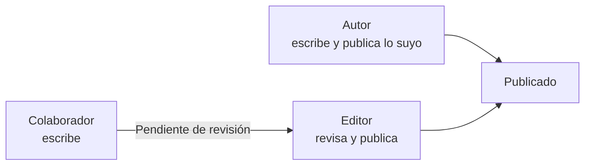

# 🛠️ Administración de gestores de contenidos

<ExportPDF />

Instalar un CMS es el principio. Después hay que administrarlo: decidir quién puede hacer qué, organizar los contenidos, ampliar sus funciones, protegerlo y garantizar que la información no se pierde. Los ejemplos de este tema usan WordPress, pero los conceptos son los mismos en Joomla, Drupal o Moodle.

## Usuarios, grupos y roles

### Usuarios

Cada persona que entra en el panel de administración necesita su propia cuenta. Las cuentas compartidas impiden saber quién hizo cada cambio y obligan a cambiar la contraseña cada vez que alguien deja el equipo.

### Roles

Un **rol** es un conjunto de permisos (en WordPress, *capacidades*) que se asigna a un usuario. WordPress trae cinco:

| Rol | Puede | No puede |
|:----|:------|:---------|
| **Administrador** | Todo: ajustes, plugins, temas, usuarios y contenidos. | — |
| **Editor** | Publicar, editar y borrar cualquier contenido, incluido el de otros, y moderar comentarios. | Cambiar ajustes, plugins, temas o usuarios. |
| **Autor** | Publicar, editar y borrar sus propias entradas y subir archivos. | Tocar el contenido de otros. |
| **Colaborador** | Escribir y editar sus propias entradas. | Publicarlas: quedan pendientes de revisión. Tampoco puede subir archivos. |
| **Suscriptor** | Editar su perfil y, si está activado, leer contenido restringido. | Crear contenido. |

### Grupos

Un **grupo** reúne a varios usuarios para darles permisos o acceso a contenidos en bloque, por ejemplo «Departamento comercial». Joomla y Drupal tienen grupos de serie; en WordPress se añaden con plugins como **Groups**, que además permite restringir contenidos por grupo.

### Perfiles a medida

Cuando los roles predefinidos no encajan, se crean roles nuevos o se modifican los existentes con un plugin como **Members** o **User Role Editor**. Por ejemplo, un rol «Gestor de comunicados» que pueda publicar entradas de la categoría *Comunicados* y nada más.

::: tip-box Principio de mínimo privilegio
Da a cada persona el rol con menos permisos que le permita hacer su trabajo. Si su cuenta se ve comprometida, el daño será menor. Los administradores deben ser muy pocos.
:::

## Organización de los contenidos

### Categorías y etiquetas

| | Categorías | Etiquetas |
|:--|:-----------|:----------|
| **Estructura** | Jerárquica: puede haber subcategorías. | Plana. |
| **Obligatoria** | Sí: toda entrada tiene al menos una. | No. |
| **Uso** | Las secciones del sitio: *Comunicados*, *Recursos*. | Temas transversales: *vacaciones*, *seguridad*. |
| **En el menú** | Es habitual enlazarlas. | Raramente. |

### Estructura del contenido

- **Jerarquía de páginas.** Las páginas pueden tener una página madre; así se construye la estructura del sitio y sus URL: `/recursos/manuales`.
- **Tipos de contenido.** Además de entradas y páginas, los plugins pueden crear tipos nuevos: productos, eventos, ofertas de empleo.
- **Relaciones.** Los enlaces internos entre contenidos ayudan a navegar y mejoran el posicionamiento en buscadores.

## Control de accesos

El control de accesos responde a dos preguntas: **quién eres** (autenticación) y **qué puedes hacer** (autorización).

- **Asignación de permisos.** Mediante roles y grupos, como se ha visto.
- **Contenido restringido.** Páginas solo para usuarios registrados o para un grupo, con plugins de membresía o con el propio sistema de niveles de acceso de Joomla.
- **Restricción del panel.** Limitar por IP el acceso a `wp-admin`, cambiar la dirección de acceso o exigir un segundo factor de autenticación.
- **Auditoría.** Revisar periódicamente qué usuarios hay, qué rol tienen y cuándo entraron por última vez, y dar de baja las cuentas que ya no se usan.

## Política de seguridad

Una política de seguridad es el conjunto de normas que se aplican al sitio. Debería recoger al menos:

| Ámbito | Medidas |
|:-------|:--------|
| **Actualizaciones** | Núcleo, temas y plugins al día. Eliminar lo que no se usa. |
| **Autenticación** | Contraseñas fuertes, límite de intentos de acceso, segundo factor para los administradores. |
| **Cuentas** | Una cuenta por persona, rol mínimo, revisión periódica. |
| **Servidor** | HTTPS, permisos de archivos correctos, PHP actualizado, editor de archivos desactivado. |
| **Copias** | Copias automáticas fuera del servidor y pruebas de restauración. |
| **Vigilancia** | Registro de actividad y alertas ante cambios sospechosos. |
| **Respuesta** | Qué hacer si el sitio es atacado: a quién avisar, cómo restaurar. |

## Registro de actividad e informes de acceso

### Registros

Hay dos fuentes de información sobre lo que pasa en el sitio:

- **Los registros del servidor web**, como `access.log` de Apache, que guardan cada petición: IP, fecha, URL, código de respuesta y navegador.
- **El registro de actividad del CMS**, que guarda las acciones de los usuarios: quién inició sesión, quién publicó o borró un contenido, quién instaló un plugin. En WordPress se activa con plugins como **WP Activity Log** o **Simple History**.

Sirven para **auditar** (saber quién hizo un cambio), para **detectar problemas** (intentos repetidos de acceso, errores) y para **investigar** un incidente.

### Análisis del comportamiento de los visitantes

Las herramientas de analítica, como Matomo (libre y autoalojable) o Google Analytics, informan de cuántas visitas recibe el sitio, qué páginas se leen más, desde dónde llegan los visitantes y en qué dispositivo. Con esos datos se mejora la estructura del sitio y se detectan contenidos que nadie encuentra.

::: warning-box Analítica y privacidad
Las herramientas de analítica que usan cookies de seguimiento requieren el consentimiento de los visitantes según el RGPD. Matomo puede configurarse para funcionar sin cookies.
:::

## Módulos y plugins

Los plugins (WordPress), extensiones (Joomla) o módulos (Drupal) añaden funciones sin programar.

### Instalación

1. Desde el repositorio oficial: **Plugins → Añadir nuevo**, buscar e instalar.
2. Subiendo un archivo `.zip` descargado del desarrollador.
3. Copiando la carpeta del plugin en `wp-content/plugins/` por SFTP.
4. Desde la línea de órdenes: `wp plugin install nombre --activate`.

### Antes de instalar un plugin

- ¿Cubre una necesidad real del sitio?
- ¿Cuándo se actualizó por última vez? ¿Es compatible con tu versión del CMS?
- ¿Cuántas instalaciones activas tiene y qué valoraciones?
- ¿Su licencia permite el uso que le vas a dar?
- ¿Hay otro plugin ya instalado que haga lo mismo?

::: danger-box Nunca instales plugins de origen dudoso
Las versiones «gratuitas» de plugins de pago que circulan por Internet suelen llevar código malicioso.
:::

### Configuración e integración

Cada plugin añade su propia pantalla de ajustes. Integrarlo bien supone configurarlo según las necesidades del sitio, comprobar que no entra en conflicto con otros plugins o con el tema, y documentar para qué se instaló.

## Temas y plantillas

### Temas

Un tema decide el aspecto de todo el sitio. Al elegirlo hay que valorar que sea **adaptable a móviles**, **accesible**, **ligero**, que se **actualice** con regularidad y que sea compatible con el editor de bloques.

### Plantillas

Dentro de un tema, una **plantilla** define cómo se muestra un tipo de página concreto: la portada, una entrada, una página, el archivo de una categoría, la página de error 404…

- En un **tema de bloques**, las plantillas se crean y editan desde **Apariencia → Editor → Plantillas**, sin código.
- En un **tema clásico**, cada plantilla es un archivo PHP del tema (`single.php`, `page.php`, `category.php`…), que se elige siguiendo la *jerarquía de plantillas* de WordPress.
- Al editar una página se puede elegir qué plantilla usa, por ejemplo una de ancho completo sin barra lateral.

Las personalizaciones del código de un tema se hacen en un **tema hijo**, para no perderlas al actualizar. Se ve en la [UP4](/up4/).

## Menús

Los menús se planifican antes de crearlos:

1. **Estructura:** qué secciones hay y cómo se agrupan, a partir de los contenidos del sitio.
2. **Jerarquía:** como máximo tres niveles.
3. **Lenguaje:** nombres que entienda el usuario, no los del organigrama interno.

Un sitio puede tener varios menús en distintas ubicaciones: principal, pie de página, enlaces legales.

## Copias de seguridad

Una copia de seguridad completa de un CMS tiene **dos partes**, y las dos son imprescindibles:

| Parte | Qué contiene | Cómo se copia a mano |
|:------|:-------------|:---------------------|
| **Base de datos** | Contenidos, usuarios, ajustes. | `mariadb-dump -u usuario -p basedatos > copia.sql` |
| **Archivos** | Núcleo, temas, plugins, `wp-config.php` y, sobre todo, `wp-content/uploads`. | `tar -czf archivos.tar.gz /var/www/wordpress` |

Plugins como **UpdraftPlus** automatizan las dos partes, las programan y las envían a un almacenamiento externo (Google Drive, Dropbox, un servidor SFTP…).

### La regla 3-2-1

- **3** copias de los datos,
- en **2** soportes distintos,
- **1** de ellas fuera del servidor y del edificio.

### Restauración

Una copia que nunca se ha restaurado no está comprobada. Hay que probar periódicamente la restauración en un entorno de pruebas: recuperar la base de datos (`mariadb -u usuario -p basedatos < copia.sql`), los archivos, y comprobar que el sitio funciona.

## Importación y exportación de contenidos

| Herramienta | Qué mueve | Formato |
|:------------|:----------|:--------|
| **Herramientas → Exportar** de WordPress | Entradas, páginas, comentarios, categorías, etiquetas y referencias a los medios. | WXR (XML de WordPress) |
| **Herramientas → Importar** | Contenidos de otro WordPress o de otras plataformas (Blogger, Tumblr…). | WXR y otros |
| Exportación de la base de datos | Todo el contenido y la configuración. | SQL |
| Plugins de importación | Productos, usuarios u otros datos en tabla. | CSV |

::: info-box Exportar no es hacer una copia de seguridad
La exportación de WordPress no incluye ajustes, plugins, temas, usuarios ni los propios archivos multimedia. Sirve para trasladar contenidos, no para recuperar un sitio.
:::

## Sindicación de contenidos

La **sindicación** permite que otras aplicaciones reciban automáticamente los contenidos nuevos de un sitio, sin que el usuario tenga que visitarlo.

- **RSS y Atom** son formatos XML que listan los últimos contenidos publicados, con título, resumen, fecha y enlace.
- WordPress publica sus *feeds* sin configurar nada: `/feed/` para las entradas, `/category/nombre/feed/` para una categoría, `/comments/feed/` para los comentarios.
- Los **lectores de feeds** (Feedly, Inoreader, Thunderbird) y los **agregadores** reúnen en un solo lugar las novedades de muchos sitios.
- A la inversa, un CMS puede **mostrar** los *feeds* de otros sitios, con el bloque RSS de WordPress o con plugins agregadores.

En una intranet, la sindicación permite, por ejemplo, que los empleados reciban en su lector los comunicados urgentes en cuanto se publican.

::: note-box Fuente
Tema elaborado a partir de los contenidos del aula de IAW del CEEDCV (curso 2025-2026). Ver [Créditos y fuentes](/general/contenidos/4-creditos).
:::

---

**Siguiente paso:** [Prácticas de la unidad →](../ejercicios/)
