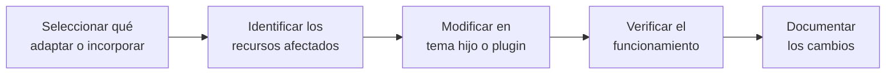

# 🧩 Adaptación de gestores de contenidos

<ExportPDF />

Cuando la configuración, los temas y los plugins disponibles no cubren lo que necesita una organización, el gestor de contenidos se adapta modificando su código. Este tema explica cómo hacerlo en WordPress **sin tocar su núcleo**, para que los cambios sobrevivan a las actualizaciones: con un tema hijo para la apariencia y con plugins propios para las funcionalidades.

## Antes de modificar: qué y dónde

Toda adaptación sigue el mismo proceso:



1. **Seleccionar la modificación.** ¿Qué necesidad cubre? ¿Existe ya un plugin fiable que lo haga? Programar solo tiene sentido si no hay alternativa o si la alternativa es peor (más pesada, de pago, poco mantenida).
2. **Identificar los recursos afectados.** Qué archivos, tablas de la base de datos o pantallas del panel intervienen.
3. **Modificar** en el lugar adecuado: tema hijo, plugin propio o *snippet*.
4. **Verificar** el funcionamiento, también en los casos límite.
5. **Documentar** qué se ha cambiado, dónde y por qué.

## Estructura de directorios de WordPress

| Ubicación | Naturaleza | Contenido | ¿Se modifica? |
|:----------|:-----------|:----------|:--------------|
| `wp-admin/` | Código PHP, CSS, JS | El panel de administración. | No: se sustituye al actualizar. |
| `wp-includes/` | Código PHP, CSS, JS | El núcleo: funciones y clases. | No: se sustituye al actualizar. |
| `wp-content/themes/` | Código PHP, CSS, JS, imágenes | Un subdirectorio por tema. | Solo los temas propios y los temas hijo. |
| `wp-content/plugins/` | Código PHP, CSS, JS | Un subdirectorio por plugin. | Solo los plugins propios. |
| `wp-content/uploads/` | Imágenes, vídeos, documentos | Los archivos subidos, por año y mes. | Lo gestiona WordPress. |
| `wp-content/languages/` | Archivos de traducción `.po`, `.mo` | Traducciones del núcleo, temas y plugins. | No. |
| `wp-config.php` | Configuración PHP | Conexión a la base de datos, claves, constantes globales. | Sí, con cuidado. |
| `.htaccess` | Configuración de Apache | Reglas de reescritura para los enlaces permanentes. | Lo genera WordPress. |

::: warning-box Por qué no se toca el núcleo ni los temas de terceros
Al actualizar WordPress, un tema o un plugin, sus archivos se sustituyen por los de la nueva versión y cualquier cambio hecho en ellos se pierde. Además, modificar el núcleo puede abrir fallos de seguridad.
:::

### Las tablas de la base de datos

Conocer las tablas principales permite identificar qué datos se ven afectados por una adaptación. Los nombres llevan el prefijo elegido al instalar (por defecto, `wp_`):

| Tabla | Contenido | Campos destacados |
|:------|:----------|:------------------|
| `wp_posts` | Entradas, páginas, revisiones, elementos de menú y otros tipos de contenido. | `ID`, `post_author`, `post_title`, `post_content`, `post_status`, `post_type`, `post_date` |
| `wp_postmeta` | Datos adicionales de cada contenido. | `post_id`, `meta_key`, `meta_value` |
| `wp_users` | Usuarios. | `ID`, `user_login`, `user_pass` (*hash*), `user_email`, `user_registered`, `display_name` |
| `wp_usermeta` | Datos adicionales de cada usuario, incluido su rol. | `user_id`, `meta_key`, `meta_value` |
| `wp_terms` | Categorías, etiquetas y otros términos. | `term_id`, `name`, `slug` |
| `wp_term_taxonomy` | A qué taxonomía pertenece cada término. | `term_id`, `taxonomy` (`category`, `post_tag`…) |
| `wp_comments` | Comentarios. | `comment_post_ID`, `comment_author`, `comment_content`, `comment_approved` |
| `wp_options` | Ajustes del sitio y de los plugins. | `option_name`, `option_value` |

## Modificar la apariencia

De menos a más intervención:

| Herramienta | Qué permite | Dónde se guarda |
|:------------|:------------|:----------------|
| **Editor del sitio** o **personalizador** | Colores, tipografías, cabecera, pie, plantillas. | En la base de datos. |
| **CSS adicional** | Reglas CSS propias sobre el tema. | En la base de datos, ligado al tema activo. |
| **Tema hijo** | Cambiar cualquier archivo del tema: CSS, plantillas, funciones. | En una carpeta propia en `wp-content/themes/`. |

### CSS adicional

En **Apariencia → Personalizar → CSS adicional** (temas clásicos) o en **Apariencia → Editor → Estilos → CSS adicional** (temas de bloques) se escriben reglas que se aplican sobre el tema:

```css
/* Cabecera con el color corporativo */
.site-header {
    background-color: #1c375b;
}

/* Botones redondeados */
.wp-element-button {
    border-radius: 999px;
}
```

Los nombres de las clases (`.site-header`, `.wp-element-button`) dependen del tema.

::: tip-box Encuentra el selector
Con el botón derecho sobre un elemento → **Inspeccionar**, las herramientas de desarrollador muestran qué clases tiene y qué reglas CSS se le aplican.
:::

### Tema hijo

Un **tema hijo** hereda todo de su **tema padre** y solo contiene lo que cambia. Al actualizar el padre, los cambios del hijo se conservan.

Para crear un tema hijo de *Twenty Twenty-Five*:

1. Crea la carpeta `wp-content/themes/intranet-child/`.
2. Crea dentro el archivo `style.css` con esta cabecera:

   ```css
   /*
    Theme Name:   Intranet (hijo de Twenty Twenty-Five)
    Template:     twentytwentyfive
    Description:  Tema hijo con la imagen corporativa de la intranet.
    Version:      1.0
    Text Domain:  intranet-child
   */

   .site-header {
       background-color: #1c375b;
   }
   ```

   `Template` es el nombre de la **carpeta** del tema padre. Es la línea que convierte a este tema en hijo.

3. Si el tema padre es clásico, crea `functions.php` para cargar las hojas de estilo del padre y del hijo:

   ```php
   <?php
   add_action('wp_enqueue_scripts', function () {
       wp_enqueue_style('padre', get_template_directory_uri() . '/style.css');
       wp_enqueue_style('hijo', get_stylesheet_uri(), ['padre']);
   });
   ```

   Los temas de bloques cargan su estilo por sí solos y suelen bastar con `style.css` y, si se quiere cambiar la paleta o las tipografías, un archivo `theme.json`.

4. Activa el tema hijo en **Apariencia → Temas**.

Para cambiar una plantilla del padre, se copia el archivo al tema hijo con el mismo nombre y se modifica la copia: WordPress usa siempre la versión del hijo si existe.

## Incorporar funcionalidades: plugins propios

Un **plugin** es una carpeta dentro de `wp-content/plugins/` con, al menos, un archivo PHP que empieza con una cabecera de comentario. WordPress lee esa cabecera para mostrarlo en la lista de plugins.

### El primer plugin

`wp-content/plugins/pie-iaw/pie-iaw.php`:

```php
<?php
/*
 * Plugin Name: Pie IAW
 * Description: Añade un aviso en el pie de todas las páginas del sitio.
 * Version:     1.0
 * Author:      Departamento de Sistemas
 * License:     GPL-2.0-or-later
 */

// Impide que el archivo se ejecute si se abre directamente por su URL
if (!defined('ABSPATH')) {
    exit;
}

add_action('wp_footer', 'pie_iaw_aviso');

function pie_iaw_aviso() {
    echo '<p style="text-align:center;padding:1em;background:#1c375b;color:#fff;">'
        . esc_html__('Sitio administrado por el departamento de sistemas', 'pie-iaw')
        . '</p>';
}
```

| Campo de la cabecera | Para qué sirve |
|:---------------------|:---------------|
| `Plugin Name` | Nombre en la lista de plugins. Es el único obligatorio. |
| `Description` | Descripción breve. |
| `Version` | Versión del plugin, para controlar actualizaciones. |
| `Author` | Quién lo ha desarrollado. |
| `License` | Licencia. Los plugins de WordPress suelen ser GPL. |

Tras guardar el archivo, el plugin aparece en **Plugins → Plugins instalados** y se activa como cualquier otro.

::: tip-box Prefija tus funciones
Todos los plugins comparten el mismo espacio de nombres. Si dos definen una función `aviso()`, el sitio deja de funcionar. Por eso las funciones de un plugin llevan su nombre como prefijo: `pie_iaw_aviso()`.
:::

### Ganchos: acciones y filtros

WordPress se integra con los plugins mediante **ganchos** (*hooks*): puntos de su ejecución en los que avisa de que algo ocurre, para que los plugins enganchen ahí sus funciones.

| | Acciones | Filtros |
|:--|:---------|:--------|
| **Para qué** | **Hacer** algo en un momento concreto. | **Modificar** un dato antes de usarlo o mostrarlo. |
| **Cómo se enganchan** | `add_action('gancho', 'funcion')` | `add_filter('gancho', 'funcion')` |
| **La función** | No devuelve nada. | Recibe el dato y **devuelve** el dato modificado. |

#### Acciones habituales

| Gancho | Cuándo se ejecuta | Uso típico |
|:-------|:------------------|:-----------|
| `init` | Cuando WordPress ha cargado, antes de procesar la petición. | Registrar tipos de contenido, taxonomías y *shortcodes*. |
| `wp_enqueue_scripts` | Al preparar la parte pública. | Cargar hojas de estilo y JavaScript. |
| `wp_head` | Dentro del `<head>` de la página. | Añadir metadatos. |
| `wp_footer` | Antes de cerrar `<body>`. | Añadir contenido o *scripts* al final de la página. |
| `admin_menu` | Al construir el menú del panel. | Añadir páginas de administración. |

Ejemplo de `wp_head`, que añade una etiqueta `meta` a todas las páginas:

```php
add_action('wp_head', function () {
    echo '<meta name="author" content="Departamento de Sistemas">' . "\n";
});
```

Ejemplo de `init`, que crea un tipo de contenido *Producto*, con su propio apartado en el panel:

```php
add_action('init', function () {
    register_post_type('producto', [
        'label'        => 'Productos',
        'public'       => true,
        'has_archive'  => true,
        'show_in_rest' => true,   // para usar el editor de bloques
        'supports'     => ['title', 'editor', 'thumbnail'],
    ]);
});
```

#### Un filtro

El filtro `the_content` recibe el contenido de cada entrada antes de mostrarlo. Este ejemplo añade un aviso al final de las entradas de la categoría *Urgentes*:

```php
add_filter('the_content', 'intranet_aviso_urgente');

function intranet_aviso_urgente($contenido) {
    if (is_single() && has_category('urgentes')) {
        $contenido .= '<p><strong>Comunicado urgente: confirma su lectura con tu responsable.</strong></p>';
    }
    return $contenido;   // un filtro siempre devuelve el dato
}
```

### *Shortcodes*

Un ***shortcode*** es una etiqueta entre corchetes que el autor escribe en un contenido y que WordPress sustituye por lo que devuelve una función. Permite insertar funcionalidades en cualquier página sin que el autor sepa programar.

```php
add_shortcode('telefono_soporte', 'intranet_telefono_soporte');

function intranet_telefono_soporte($atributos) {
    $a = shortcode_atts(['ext' => '100'], $atributos);
    return '<p>Soporte técnico: extensión ' . esc_html($a['ext']) . '</p>';
}
```

En una página, `[telefono_soporte]` muestra la extensión 100 y `[telefono_soporte ext="205"]`, la 205.

::: warning-box Un shortcode devuelve, no imprime
La función de un *shortcode* debe **devolver** el HTML con `return`. Si lo imprime con `echo`, aparecerá en un lugar equivocado de la página.
:::

### Una página en el panel de administración con datos de la base de datos

Este plugin añade al panel un apartado **Usuarios WP** con una tabla de los usuarios registrados. Para acceder a la base de datos usa el objeto `$wpdb` de WordPress, que ya tiene la conexión abierta con los datos de `wp-config.php`: no hace falta escribir usuario ni contraseña en el plugin.

`wp-content/plugins/tabla-usuarios/tabla-usuarios.php`:

```php
<?php
/*
 * Plugin Name: Tabla de usuarios
 * Description: Muestra en el panel una tabla con los usuarios registrados.
 * Version:     1.0
 * License:     GPL-2.0-or-later
 */

if (!defined('ABSPATH')) {
    exit;
}

add_action('admin_menu', 'tabla_usuarios_menu');

function tabla_usuarios_menu() {
    add_menu_page(
        'Tabla de usuarios',       // título de la página
        'Usuarios WP',             // texto del menú
        'list_users',              // capacidad necesaria para verlo
        'tabla-usuarios',          // identificador (slug) de la página
        'tabla_usuarios_pagina',   // función que pinta la página
        'dashicons-groups',        // icono
        70                         // posición en el menú
    );
}

function tabla_usuarios_pagina() {
    global $wpdb;

    $usuarios = $wpdb->get_results(
        "SELECT user_login, user_email, user_registered
           FROM {$wpdb->users}
          ORDER BY user_registered DESC"
    );
    ?>
    <div class="wrap">
        <h1>Usuarios de WordPress</h1>
        <table class="widefat striped">
            <thead>
                <tr><th>Usuario</th><th>Correo</th><th>Fecha de registro</th></tr>
            </thead>
            <tbody>
            <?php foreach ($usuarios as $u) : ?>
                <tr>
                    <td><?php echo esc_html($u->user_login); ?></td>
                    <td><?php echo esc_html($u->user_email); ?></td>
                    <td><?php echo esc_html($u->user_registered); ?></td>
                </tr>
            <?php endforeach; ?>
            </tbody>
        </table>
    </div>
    <?php
}
```

| Elemento | Qué hace |
|:---------|:---------|
| `add_menu_page()` | Añade una entrada al menú del panel. El tercer parámetro es la **capacidad** que debe tener el usuario para verla. |
| `$wpdb->users` | El nombre real de la tabla de usuarios, con el prefijo de esta instalación. |
| `$wpdb->get_results()` | Ejecuta una consulta y devuelve las filas como objetos. |
| `wrap`, `widefat`, `striped` | Clases CSS del propio panel de WordPress, para que la página tenga su mismo aspecto. |
| `esc_html()` | Escapa cada dato antes de mostrarlo. |

#### Consultas con datos variables

Si una consulta incluye un dato que viene del usuario, se prepara con `$wpdb->prepare()`, que hace el papel de las sentencias preparadas de PDO:

```php
$fila = $wpdb->get_row(
    $wpdb->prepare("SELECT * FROM {$wpdb->users} WHERE user_login = %s", $login)
);
```

`%s` marca un texto, `%d` un entero y `%f` un decimal.

### Crear una tabla propia al activar el plugin

Si el plugin necesita guardar sus propios datos, crea su tabla al activarse con `register_activation_hook`. Así se hace una sola vez y no en cada carga de página:

```php
register_activation_hook(__FILE__, 'avisos_crear_tabla');

function avisos_crear_tabla() {
    global $wpdb;
    $tabla = $wpdb->prefix . 'avisos';
    $charset = $wpdb->get_charset_collate();

    $sql = "CREATE TABLE $tabla (
        id mediumint(9) NOT NULL AUTO_INCREMENT,
        titulo varchar(200) NOT NULL,
        fecha datetime NOT NULL,
        PRIMARY KEY  (id)
    ) $charset;";

    require_once ABSPATH . 'wp-admin/includes/upgrade.php';
    dbDelta($sql);
}
```

Compara con el [ejemplo guiado de Code Snippets](./2-ejemplo-code-snippets), donde la misma tarea se hace con un *snippet* que hay que activar y desactivar a mano.

## Verificar los cambios

- **Modo de depuración.** En un entorno de pruebas, activa en `wp-config.php`:

  ```php
  define('WP_DEBUG', true);
  define('WP_DEBUG_LOG', true);       // errores en wp-content/debug.log
  define('WP_DEBUG_DISPLAY', false);  // sin mostrarlos en la página
  ```

- **Query Monitor.** Plugin que muestra, en cada página, las consultas a la base de datos, los ganchos ejecutados y los errores de PHP.
- **Pruebas con distintos roles**, para comprobar que una página de administración no la ve quien no debe.
- **Casos límite:** tabla vacía, datos con caracteres especiales, plugin desactivado y vuelto a activar.
- **Recuperación.** Si un plugin propio deja el sitio en blanco, se desactiva cambiando el nombre de su carpeta en `wp-content/plugins/` por SFTP.

## Documentar los cambios

La documentación de una adaptación debe recoger:

- **Qué necesidad** cubre y por qué se resolvió con código propio.
- **Dónde** está: tema hijo, plugin, tabla de la base de datos.
- **Qué hace** cada archivo y cada función, con comentarios en el propio código.
- **Cómo se prueba** y cómo se deshace.
- **Versión** y fecha de cada cambio. Guardar el tema hijo y los plugins propios en un repositorio Git es la forma más sencilla de llevar ese control.

::: note-box Fuente
Tema elaborado a partir de los contenidos del aula de IAW del CEEDCV (Sergio Pérez Rubio, curso 2025-2026). Ver [Créditos y fuentes](/general/contenidos/4-creditos).
:::

---

**Siguiente paso:** [Ejemplo guiado: Code Snippets →](./2-ejemplo-code-snippets)
