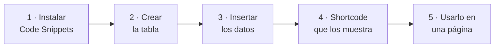

# 🧩 Ejemplo guiado: uso de Code Snippets

<ExportPDF />

**Code Snippets** es un plugin de WordPress que permite añadir fragmentos de código PHP desde el panel de administración, sin editar los archivos del tema ni del núcleo. En este ejemplo se crea una tabla propia en la base de datos de WordPress, se rellena con datos y se muestra en una página.



## 1. Instalar y preparar Code Snippets

1. En el panel de WordPress ve a **Plugins → Añadir nuevo**.
2. Busca **«Code Snippets»**.
3. Instálalo y actívalo.
4. Ve a **Snippets → Añadir nuevo**.
5. Elige **Tipo: PHP Snippet**.
6. Marca la opción **«Ejecutar en todo el sitio»**.

## 2. Crear la tabla de incidencias en la base de datos

Este *snippet* se ejecuta **una sola vez** para crear la tabla.

### Estructura de la tabla

Campos mínimos:

| Campo | Tipo | Contenido |
|:------|:-----|:----------|
| `id` | `mediumint(9)`, autoincremental | Identificador de la incidencia. |
| `fecha_hora_incidencia` | `datetime` | Cuándo se produjo. |
| `descripcion` | `text` | Qué ocurrió. |
| `quien_abre` | `varchar(100)` | Quién la comunicó. |
| `fecha_resolucion` | `datetime` | Cuándo se resolvió. |

### Snippet PHP: crear la tabla

```php
global $wpdb;

$tabla = $wpdb->prefix . 'incidencias_resueltas';
$charset_collate = $wpdb->get_charset_collate();

$sql = "CREATE TABLE IF NOT EXISTS $tabla (
    id mediumint(9) NOT NULL AUTO_INCREMENT,
    fecha_hora_incidencia datetime NOT NULL,
    descripcion text NOT NULL,
    quien_abre varchar(100) NOT NULL,
    fecha_resolucion datetime NOT NULL,
    PRIMARY KEY (id)
) $charset_collate;";

require_once(ABSPATH . 'wp-admin/includes/upgrade.php');
dbDelta($sql);
```

Guarda y **activa el snippet**. A partir de ese momento la tabla existe en la base de datos.

::: info-box ¿Qué es $wpdb?
`$wpdb` es el objeto con el que WordPress accede a su base de datos. `$wpdb->prefix` devuelve el prefijo de tablas de la instalación (por defecto `wp_`), de modo que la tabla se llamará `wp_incidencias_resueltas`. La función `dbDelta()` crea la tabla o la ajusta si ya existía.
:::

## 3. Rellenar la tabla con incidencias resueltas

Este *snippet* inserta varias incidencias de ejemplo.

### Snippet PHP: insertar datos

```php
global $wpdb;

$tabla = $wpdb->prefix . 'incidencias_resueltas';

$wpdb->insert($tabla, array(
    'fecha_hora_incidencia' => '2025-01-15 09:30:00',
    'descripcion' => 'Error en acceso al panel de usuario',
    'quien_abre' => 'Juan Pérez',
    'fecha_resolucion' => '2025-01-15 11:00:00'
));

$wpdb->insert($tabla, array(
    'fecha_hora_incidencia' => '2025-01-18 14:20:00',
    'descripcion' => 'Fallo en envío de correos',
    'quien_abre' => 'María López',
    'fecha_resolucion' => '2025-01-18 16:45:00'
));

$wpdb->insert($tabla, array(
    'fecha_hora_incidencia' => '2025-01-22 10:10:00',
    'descripcion' => 'Problema con actualización de plugins',
    'quien_abre' => 'Carlos Ruiz',
    'fecha_resolucion' => '2025-01-22 12:30:00'
));

$wpdb->insert($tabla, array(
    'fecha_hora_incidencia' => '2025-01-25 08:00:00',
    'descripcion' => 'Error 404 en página de contacto',
    'quien_abre' => 'Ana Gómez',
    'fecha_resolucion' => '2025-01-25 09:15:00'
));
```

::: warning-box Actívalo una sola vez
Un *snippet* marcado como «Ejecutar en todo el sitio» se ejecuta en cada carga de página. Actívalo **una sola vez** y después **desactívalo**, o los datos se duplicarán.
:::

## 4. Crear el snippet para mostrar las incidencias

Las incidencias se muestran ordenadas por fecha. Para poder colocar la tabla donde se quiera, se define un ***shortcode***.

### Snippet PHP: mostrar incidencias resueltas

```php
function mostrar_incidencias_resueltas() {
    global $wpdb;
    $tabla = $wpdb->prefix . 'incidencias_resueltas';

    $resultados = $wpdb->get_results(
        "SELECT * FROM $tabla ORDER BY fecha_resolucion DESC"
    );

    if (empty($resultados)) {
        return '<p>No hay incidencias resueltas.</p>';
    }

    $salida = '<table style="width:100%; border-collapse: collapse;">';
    $salida .= '<thead>
        <tr>
            <th>Fecha incidencia</th>
            <th>Descripción</th>
            <th>Abierta por</th>
            <th>Fecha resolución</th>
        </tr>
    </thead><tbody>';

    foreach ($resultados as $incidencia) {
        $salida .= '<tr>
            <td>' . date('d/m/Y H:i', strtotime($incidencia->fecha_hora_incidencia)) . '</td>
            <td>' . esc_html($incidencia->descripcion) . '</td>
            <td>' . esc_html($incidencia->quien_abre) . '</td>
            <td>' . date('d/m/Y H:i', strtotime($incidencia->fecha_resolucion)) . '</td>
        </tr>';
    }

    $salida .= '</tbody></table>';

    return $salida;
}

add_shortcode('incidencias_resueltas', 'mostrar_incidencias_resueltas');
```

::: tip-box Escapa siempre la salida
`esc_html()` convierte los caracteres especiales de HTML antes de mostrarlos. Así, si una descripción contiene etiquetas o *scripts*, se muestran como texto y no se ejecutan en el navegador.
:::

## 5. Enlazar esta funcionalidad en WordPress

1. Ve a **Páginas** o **Entradas**.
2. Edita la página donde quieras mostrar las incidencias.
3. Añade el *shortcode*:

   ```text
   [incidencias_resueltas]
   ```

4. Guarda y publica.

Al visitar la página, WordPress sustituye el *shortcode* por la tabla que devuelve la función.

---

**Siguiente paso:** [Práctica P4.1 →](../ejercicios/1-code-snippets)
