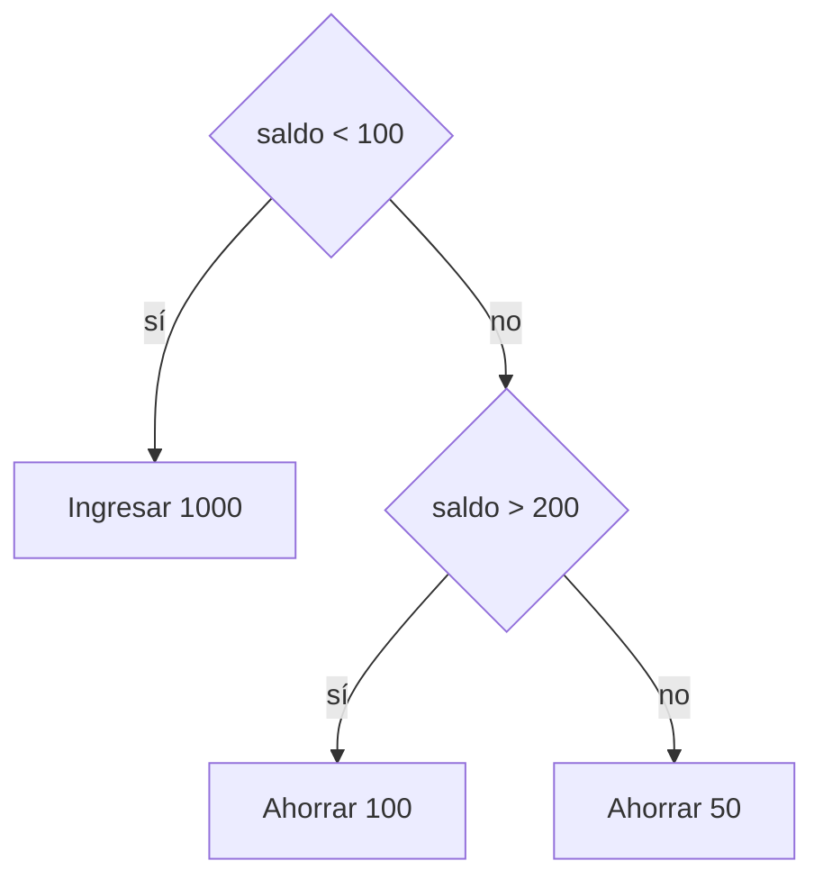

# 🔀 Tema 2 — Expresiones y control de flujo

<ExportPDF />

::: info-box Diapositivas del tema
Este tema tiene presentación de clase: [ver las diapositivas](../diapositivas/2-control-flujo).
:::

## Condicionales

Los condicionales alteran el flujo del programa. Permiten hacer preguntas sobre ciertas condiciones y responder de diferentes maneras según la respuesta.

PHP tiene tres tipos de condicionales:

- `if`
- `switch`
- el operador `?` (ternario)

### Condicional simple: `if`

```php
if ($bank_balance < 100) {
    $money = 1000;
    $bank_balance += $money;
}
```

- Si el saldo es menor que 100, añade 1000 a la cuenta.
- Si es mayor o igual que 100, ignora el bloque y continúa con el código siguiente.

### La instrucción `else`

Cuando la condición del `if` no es `TRUE`, el `else` permite realizar una acción alternativa.

```php
if ($bank_balance < 100) {
    $money = 1000;
    $bank_balance += $money;
} else {
    $savings += 50;
    $bank_balance -= 50;
}
```

### La instrucción `elseif`

`elseif` permite manejar varias posibilidades basadas en condiciones distintas. Se evalúan en orden y se ejecuta solo el primer bloque cuya condición se cumple.

```php
if ($bank_balance < 100) {
    $money = 1000;
    $bank_balance += $money;
} elseif ($bank_balance > 200) {
    $savings += 100;
    $bank_balance -= 100;
} else {
    $savings += 50;
    $bank_balance -= 50;
}
```



### La instrucción `switch`

`switch` compara una misma variable con una lista de valores y ejecuta el bloque del valor que coincide.

```php
<?php
switch ($page) {
    case "Home":
        echo "Has seleccionado Home";
        break;
    case "About":
        echo "Has seleccionado About";
        break;
    case "News":
        echo "Has seleccionado News";
        break;
    case "Login":
        echo "Has seleccionado Login";
        break;
    case "Links":
        echo "Has seleccionado Links";
        break;
    default:
        echo "Selección no reconocida";
        break;
}
?>
```

#### Importancia del `break`

La instrucción `break` es fundamental para salir del `switch` una vez que se ha cumplido una condición. Si no se incluye, se ejecutarán también todos los casos posteriores.

```php
<?php
switch ($page) {
    case "Home":
        echo "Has seleccionado Home";
        // Si omites el break, todos los casos siguientes también se ejecutarán.
    case "About":
        echo "Has seleccionado About";
    case "News":
        echo "Has seleccionado News";
}
?>
```

Con `$page = "Home"`, este código muestra los tres mensajes seguidos.

#### Acción por defecto: `default`

`default` se utiliza para manejar los casos en los que no se cumple ninguna de las condiciones especificadas en los `case`.

```php
<?php
switch ($page) {
    case "Home":
        echo "Has seleccionado Home";
        break;
    // Otros casos...
    default:
        echo "Selección no reconocida";
        break;
}
?>
```

#### Sintaxis alternativa

PHP permite una sintaxis alternativa para `switch`: se escribe `switch (...):` en lugar de la llave de apertura `{`, y `endswitch;` en lugar de la llave de cierre `}`.

```php
<?php
switch ($page):
    case "Home":
        echo "Has seleccionado Home";
        break;
    case "Links":
        echo "Has seleccionado Links";
        break;
endswitch;
?>
```

### El operador ternario `?`

El operador ternario es una forma compacta de escribir un `if…else` que devuelve un valor: `condición ? valor_si_verdadero : valor_si_falso`.

```php
echo $bank_balance < 100 ? "Saldo bajo" : "Saldo suficiente";
```

## Bucles

Los bucles permiten repetir una secuencia de código hasta que se cumpla una condición. Son útiles para tareas que requieren repetición sin necesidad de escribir el mismo código varias veces.

### El bucle `while`

Repite el bloque mientras la condición sea verdadera. La condición se evalúa **antes** de cada vuelta.

```php
<?php
$fuel = 10;
while ($fuel > 1) {
    echo "There's enough fuel";
}
?>
```

::: danger-box Bucle infinito
En este ejemplo `$fuel` nunca cambia dentro del bucle, así que la condición siempre se cumple y el bucle no termina. Para que un `while` acabe, algo dentro del bloque tiene que modificar la condición, por ejemplo `$fuel--;`.
:::

#### Un `while` más compacto

El operador de incremento puede colocarse dentro de la condición del bucle para simplificar el código. Este ejemplo muestra la tabla de multiplicar del 12:

```php
<?php
$count = 0;
while (++$count <= 12)
    echo "$count times 12 is " . $count * 12 . "<br>";
?>
```

### El bucle `do…while`

Garantiza que el bloque se ejecute **al menos una vez**, porque la condición se evalúa después de cada vuelta.

```php
<?php
$count = 1;
do {
    echo "$count times 12 is " . $count * 12 . "<br>";
} while (++$count <= 12);
?>
```

### El bucle `for`

Es ideal para situaciones en las que se conoce el número exacto de iteraciones. Combina la inicialización, la condición y la modificación en una sola línea.

```php
<?php
for ($count = 1; $count <= 12; ++$count) {
    echo "$count times 12 is " . $count * 12 . "<br>";
}
?>
```

### ¿Qué bucle elegir?

| Bucle | Cuándo se evalúa la condición | Úsalo cuando… |
|:------|:------------------------------|:--------------|
| `while` | Antes de cada vuelta | No sabes cuántas veces se repetirá y puede que ninguna. |
| `do…while` | Después de cada vuelta | El bloque debe ejecutarse al menos una vez. |
| `for` | Antes de cada vuelta | Conoces el número de repeticiones. |

---

**Siguiente tema:** [Funciones →](./3-funciones)
