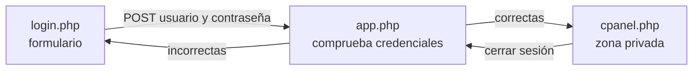

# 🍪 Tema 6 — Cookies, sesiones y autenticación

<ExportPDF />

::: info-box Diapositivas del tema
Este tema tiene presentación de clase: [ver las diapositivas](../diapositivas/6-cookies-sesiones).
:::

HTTP es un protocolo sin estado: cada petición es independiente y el servidor no recuerda las anteriores. Las cookies y las sesiones son los dos mecanismos que permiten mantener información entre una página y la siguiente.

| | Cookies | Sesiones |
|:--|:--------|:---------|
| **Dónde se guardan los datos** | En el navegador del usuario. | En el servidor. |
| **Duración** | Hasta la fecha de expiración que se indique. | Hasta que se cierra el navegador o expira la sesión. |
| **Uso habitual** | Preferencias: idioma, tema. | Usuario autenticado, carrito de la compra. |
| **¿Puede modificarlas el usuario?** | Sí. | No: el navegador solo guarda el identificador de sesión. |

## Cookies

### Crear una cookie

Las cookies permiten almacenar información en el navegador del usuario para su uso posterior: seguimiento de sesiones, detalles de autenticación o preferencias. En PHP, las cookies se establecen con la función `setcookie`.

```php
setcookie('location', 'USA', time() + 60 * 60 * 24 * 7, '/');
```

En este ejemplo se establece una cookie llamada `location` con el valor `USA`, que será válida durante 7 días y accesible desde todo el dominio. La fecha de expiración se calcula como el momento actual más 7 días en segundos.

::: warning-box setcookie va antes de cualquier salida
Las cookies viajan en las cabeceras HTTP, así que `setcookie` debe llamarse antes de que el script envíe ningún contenido: ni HTML, ni un `echo`, ni siquiera una línea en blanco antes de `<?php`.
:::

::: info-box Más información
Manual de PHP: [setcookie](https://www.php.net/manual/es/function.setcookie.php).
:::

### Acceder a una cookie

Para acceder a una cookie se usa el array superglobal `$_COOKIE`, que almacena los valores de las cookies enviadas por el navegador.

```php
if (isset($_COOKIE['location'])) $location = $_COOKIE['location'];
```

Este código verifica si la cookie `location` existe y, en caso afirmativo, asigna su valor a la variable `$location`.

```php
<?php
echo 'Hello ' . htmlspecialchars($_COOKIE["name"]) . '!';
?>
```

Es importante recordar que la cookie tiene que haber sido enviada antes de poder acceder a ella: una cookie creada con `setcookie` no aparece en `$_COOKIE` hasta la **siguiente** petición del navegador.

### Eliminar una cookie

Para eliminar una cookie se establece su fecha de expiración en el pasado, usando de nuevo `setcookie`. Eso le indica al navegador que debe borrarla.

```php
setcookie('location', 'USA', time() - 2592000, '/');
```

Este código elimina la cookie `location` poniendo su expiración en una fecha pasada (en este caso, hace un mes).

### Ejemplo completo sobre cookies

Dos páginas: la primera guarda en cookies el nombre y el idioma que elige el usuario; la segunda las lee y saluda en ese idioma.

::: tabs

== cookie_formulario.php

```php
<?php
// Verificamos si el formulario fue enviado
if ($_SERVER["REQUEST_METHOD"] == "POST") {
    // Guardamos el nombre y el idioma en cookies por 30 días
    setcookie("nombre", $_POST["nombre"], time() + (30 * 24 * 60 * 60), "/"); // 30 días
    setcookie("idioma", $_POST["idioma"], time() + (30 * 24 * 60 * 60), "/"); // 30 días
}
?>

<!DOCTYPE html>
<html lang="es">
<head>
    <meta charset="UTF-8">
    <meta name="viewport" content="width=device-width, initial-scale=1.0">
    <title>Formulario de Preferencias</title>
</head>
<body>
    <h1>Introduce tu nombre y selecciona el idioma</h1>

    <!-- Formulario para ingresar nombre e idioma -->
    <form method="POST">
        <label for="nombre">Nombre:</label>
        <input type="text" name="nombre" id="nombre" required>
        <br><br>

        <label for="idioma">Idioma:</label>
        <select name="idioma" id="idioma" required>
            <option value="es">Español</option>
            <option value="en">Inglés</option>
            <option value="fr">Francés</option>
        </select>
        <br><br>

        <button type="submit">Guardar preferencias</button>
    </form>

</body>
</html>
```

== cookie_mostrar.php

```php
<?php
// Verificamos si las cookies están configuradas
if (isset($_COOKIE["nombre"]) && isset($_COOKIE["idioma"])) {
    $nombre = $_COOKIE["nombre"];
    $idioma = $_COOKIE["idioma"];
} else {
    $nombre = "Invitado";
    $idioma = "es"; // Español por defecto
}
?>

<!DOCTYPE html>
<html lang="<?php echo $idioma; ?>">
<head>
    <meta charset="UTF-8">
    <meta name="viewport" content="width=device-width, initial-scale=1.0">
    <title>Bienvenido</title>
</head>
<body>
    <h1>Bienvenido, <?php echo htmlspecialchars($nombre); ?>!</h1>

    <?php
    // Mensaje según el idioma seleccionado
    if ($idioma == "es") {
        echo "<p>Hola, ¿cómo estás?</p>";
    } elseif ($idioma == "en") {
        echo "<p>Hello, how are you?</p>";
    } elseif ($idioma == "fr") {
        echo "<p>Bonjour, comment ça va ?</p>";
    }
    ?>
</body>
</html>
```

:::

::: tip-box Variante: alta y lectura en la misma página
Si la misma página guarda y lee las cookies, tras llamar a `setcookie` hay que redirigir para que la página se recargue y las cookies ya estén disponibles:

```php
header("Location: " . $_SERVER["PHP_SELF"]);
exit;
```
:::

## Sesiones

En PHP, las sesiones son una forma de almacenar información **en el servidor** para que esté disponible durante varias páginas de navegación. A diferencia de las cookies, que se almacenan en el navegador del usuario, las sesiones mantienen los datos durante la visita de un usuario, hasta que se cierra el navegador o expira la sesión.

Tres utilidades de las sesiones en PHP:

1. **Autenticación de usuarios:** permite mantener al usuario autenticado entre varias páginas, sin necesidad de iniciar sesión repetidamente.
2. **Seguimiento del carrito de la compra:** almacena los productos seleccionados mientras el usuario navega por el sitio.
3. **Almacenamiento de datos temporales:** guarda preferencias o configuraciones del usuario durante su sesión, como idioma o tema.

### Iniciar una sesión

Para iniciar una sesión se utiliza la función `session_start()`, y a partir de ahí las variables de sesión se almacenan en el array `$_SESSION`.

```php
// pag1.php
session_start();
$_SESSION['forename'] = 'Carlos';
$_SESSION['surname'] = 'Gómez';
echo "Hola, " . $_SESSION['forename'] . " " . $_SESSION['surname'];
```

La salida es `Hola, Carlos Gómez`. La sesión se inicia con `session_start()`, y las variables de nombre y apellido se guardan en el array `$_SESSION`.

### Recuperar variables de sesión

Las variables de sesión se pueden recuperar en páginas posteriores utilizando `$_SESSION`. Cada página que use la sesión debe llamar primero a `session_start()`.

```php
// pag2.php
session_start();
if (isset($_SESSION['forename'])) {
    $forename = $_SESSION['forename'];
    echo "Bienvenido de nuevo, $forename.";
} else {
    echo "Por favor, inicia.";
}
```

Si se visita después de `pag1.php`, la salida es `Bienvenido de nuevo, Carlos.` Se recupera el valor almacenado en `$_SESSION['forename']` y se muestra al usuario. Si no hay ninguna sesión activa, se solicita iniciar sesión.

### Finalizar una sesión

Para cerrar una sesión se utiliza `session_destroy()`, que elimina todos los datos de la sesión.

```php
session_start();
session_destroy();
echo "Has cerrado sesión.";
```

### Ejemplo completo sobre sesiones

Una zona privada mínima con tres archivos: el formulario de acceso, el script que comprueba las credenciales y cierra la sesión, y el panel al que solo se entra autenticado.



::: tabs

== login.php

```php
<?php
session_start();
if (isset($_SESSION['usuario'])) {
    header('Location: cpanel.php');  // Si el usuario ya está autenticado, redirigir al dashboard
    exit;
}

// Mostrar el mensaje de error si está presente
$error = isset($_SESSION['error']) ? $_SESSION['error'] : '';
if ($error) {
    // Borrar el mensaje después de mostrarlo
    unset($_SESSION['error']);
}
?>

<!DOCTYPE html>
<html lang="es">
<head>
    <meta charset="UTF-8">
    <meta name="viewport" content="width=device-width, initial-scale=1.0">
    <title>Login</title>
</head>
<body>
    <h2>Iniciar sesión</h2>
    <?php if ($error) { echo "<p style='color:red;'>$error</p>"; } ?>
    <form method="POST" action="app.php">
        <label for="username">Usuario:</label>
        <input type="text" id="username" name="username" required><br><br>
        <label for="password">Contraseña:</label>
        <input type="password" id="password" name="password" required><br><br>
        <button type="submit" name="login">Iniciar sesión</button>
    </form>
</body>
</html>
```

== app.php

```php
<?php
session_start();

// Simulación de base de datos de usuarios
$usuarios = [
    "usuario1" => "contraseña123",
    "usuario2" => "contraseña456"
];

// Ruta para el login
if (isset($_POST['login'])) {
    $username = $_POST['username'];
    $password = $_POST['password'];

    // Verificar si el usuario existe y la contraseña es correcta
    if (array_key_exists($username, $usuarios) && $usuarios[$username] === $password) {
        $_SESSION['usuario'] = $username;  // Guardar el usuario en la sesión
        header('Location: cpanel.php');  // Redirigir al dashboard
        exit;
    } else {
        $_SESSION['error'] = "Credenciales incorrectas. Intenta de nuevo.";  // Almacenar el mensaje de error
        header('Location: login.php');  // Redirigir al login
        exit;
    }
}

// Ruta para cerrar sesión
if (isset($_GET['logout'])) {
    session_unset();  // Eliminar todas las variables de sesión
    session_destroy();  // Destruir la sesión
    header('Location: login.php');  // Redirigir al login
    exit;
}
?>
```

== cpanel.php

```php
<?php
session_start();
if (!isset($_SESSION['usuario'])) {
    header('Location: login.php');  // Si el usuario no está autenticado, redirigir al login
    exit;
}

$usuario = $_SESSION['usuario'];
?>

<!DOCTYPE html>
<html lang="es">
<head>
    <meta charset="UTF-8">
    <meta name="viewport" content="width=device-width, initial-scale=1.0">
    <title>Dashboard</title>
</head>
<body>
    <h1>Bienvenido, <?php echo htmlspecialchars($usuario); ?>!</h1>
    <p>Este es tu PANEL DE CONTROL privado.</p>
    <a href="app.php?logout=true">Cerrar sesión</a>
</body>
</html>
```

:::

Las claves del ejemplo:

- **Cada página privada empieza comprobando la sesión.** Si `$_SESSION['usuario']` no existe, redirige al formulario. Sin esa comprobación, cualquiera podría entrar escribiendo la URL de `cpanel.php`.
- **Después de `header('Location: …')` va siempre `exit`**, para que el resto del script no se ejecute.
- **El mensaje de error se pasa por la sesión** y se borra tras mostrarlo, para que no reaparezca al recargar.

::: warning-box Las contraseñas de este ejemplo están en texto claro
Aquí los usuarios están en un array con la contraseña a la vista, para centrarse en el mecanismo de sesiones. En el apartado siguiente se ve cómo guardarlas correctamente.
:::

## Autenticación de usuarios

### Guardar contraseñas: *hashes*

Es importante almacenar las contraseñas de manera segura. En lugar de guardarlas como texto claro, se deben usar funciones de *hash* unidireccionales para protegerlas.

```php
echo password_hash("mypassword", PASSWORD_DEFAULT);
// p. ej. $2y$10$aqlU1J7QjqlQh9xWHvGWPuP5e6BFksgQmq.jS/w0ti7g9m0GBkXiC
```

La función `password_hash` genera un *hash* seguro de la contraseña utilizando un algoritmo moderno. El valor generado incluye una **sal** aleatoria, lo que hace más difícil descifrar la contraseña. Por eso, cada vez que se ejecuta produce un resultado distinto, aunque la contraseña sea la misma.

### Verificar una contraseña

Para verificar si una contraseña introducida coincide con el *hash* almacenado se usa la función `password_verify`.

```php
if (password_verify("mypassword", $hash))
    echo "Válido";
```

La función `password_verify` compara la contraseña introducida con el *hash* almacenado. Si coinciden, devuelve `TRUE`.

::: danger-box Nunca compares hashes con el operador de igualdad
Como cada *hash* lleva una sal distinta, generar un nuevo *hash* y compararlo con el guardado no funciona. La comparación se hace siempre con `password_verify`.
:::

### Ejemplo completo: acceso con contraseñas cifradas

::: tabs

== login.html

```html
<!DOCTYPE html>
<html lang="es">
<head>
    <meta charset="UTF-8">
    <title>Login</title>
</head>
<body>

<h2>Acceso de usuarios</h2>

<form action="procesar_login.php" method="post">
    <label>Usuario:</label><br>
    <input type="text" name="usuario" required><br><br>

    <label>Contraseña:</label><br>
    <input type="password" name="password" required><br><br>

    <input type="submit" value="Entrar">
</form>

</body>
</html>
```

== procesar_login.php

```php
<?php
// Array asociativo con usuarios y contraseñas hasheadas
$usuarios = [
    "juan"  => password_hash("1234", PASSWORD_DEFAULT),
    "ana"   => password_hash("password", PASSWORD_DEFAULT),
    "admin" => password_hash("admin123", PASSWORD_DEFAULT)
];

// Recogemos datos del formulario
$usuario = $_POST['usuario'] ?? '';
$password = $_POST['password'] ?? '';

// Comprobamos si el usuario existe
if (array_key_exists($usuario, $usuarios)) {

    // Verificamos la contraseña
    if (password_verify($password, $usuarios[$usuario])) {
        echo "<h1>Accediendo a ZONA PRIVADA</h1>";
        exit;
    }
}

// Si llega aquí, usuario o contraseña incorrectos
header("Location: login.html");
exit;
```

:::

::: note-box Sobre este ejemplo
Para que el ejemplo funcione sin base de datos, los *hashes* se calculan en cada ejecución a partir de contraseñas escritas en el código. En una aplicación real el *hash* se calcula una sola vez, al registrar al usuario, y lo único que se guarda es el *hash*.
:::

### Autenticación con base de datos

La autenticación puede realizarse utilizando una base de datos, donde se almacenan los *hashes* de las contraseñas. Se hace una consulta para obtener los datos del usuario y se verifica la contraseña con `password_verify`.

```php
<?php
// $pdo es una conexión PDO ya abierta
// $un_temp y $pw_temp son el usuario y la contraseña recibidos del formulario
$stmt = $pdo->prepare("SELECT * FROM users WHERE username = ?");
$stmt->execute([$un_temp]);
$row = $stmt->fetch();

if (!$row) die("Usuario no encontrado");

if (password_verify($pw_temp, $row['password']))
    echo "Bienvenido " . htmlspecialchars($row['forename']);
else
    die("Combinación de usuario/contraseña inválida");
?>
```

::: danger-box No construyas la consulta concatenando variables
En la diapositiva, la consulta se escribe insertando la variable directamente en el texto SQL (`"SELECT * FROM users WHERE username=$un_temp"`). Eso permite la **inyección de SQL**: un usuario puede escribir código SQL en el campo del formulario y alterar la consulta. En estos apuntes se usa una **sentencia preparada**, en la que el dato viaja separado de la consulta. Se explica en [UP6 · Acceso a datos con PDO](/up6/contenidos/1-acceso-datos-pdo).
:::

---

**Siguiente paso:** [Prácticas de la unidad →](../ejercicios/)
