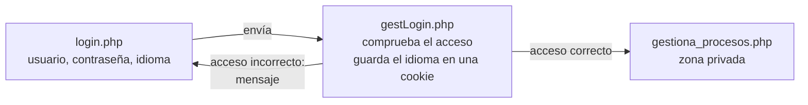

# 📋 P5.6 — Monitorización de sistemas: zona privada con sesiones y cookies

<ExportPDF />

::: info-box Ficha de la práctica
- **Unidad:** UP5 · RA5.
- **Criterios de evaluación:** 5f, 5g, 5h, 5i.
- **Proyecto:** segunda aproximación del [panel de control de procesos](./).
- **Punto de partida:** la página de la [P5.5](./5-monitorizacion-procesos).
- **Entrega:** código PHP comentado y demostración de su funcionamiento.
:::

## Objetivos

1. Realizar páginas privadas a las que solo sea posible entrar después de que el administrador se haya identificado.
2. Entender y hacer uso de cookies y de variables de sesión para personalizar la experiencia del usuario.

## Descripción

Se parte de la página que permite controlar los procesos, y se supone que dicha página se llama `gestiona_procesos.php`. La aplicación pasa a tener tres páginas:

## Requisitos

1. El acceso a la página `gestiona_procesos.php` debe ser privado.
2. Crear un formulario, en una página llamada `login.php`, que solicite al usuario su nombre de usuario, su contraseña y el idioma antes de poder acceder a ella.
3. Los idiomas que se pueden elegir son «Español», «Valenciano» e «Inglés».
4. La información de usuario, contraseña e idioma se envía a una página llamada `gestLogin.php`, que comprueba si el acceso es correcto y, además, almacena el idioma elegido en una cookie.
5. Si el acceso es correcto, el usuario podrá gestionar los procesos.
6. Si el acceso es incorrecto, se le informa con un mensaje y se le reenvía de nuevo a la página de acceso.
7. El idioma del texto de la página de procesos dependerá del idioma elegido por el usuario en la página de acceso.
8. Se deben usar también sesiones, para el caso de que un usuario que ya se ha identificado correctamente acceda directamente a la zona privada.

## Entregable

- Código PHP de las tres páginas, comentado.
- Demostración del funcionamiento: acceso correcto, acceso incorrecto, cambio de idioma e intento de entrar a la zona privada sin identificarse.

## Rúbrica

Escala común del módulo: [niveles 0–4](/general/contenidos/3-evaluacion). El nivel 0 corresponde a no entregado o sin relación con lo solicitado.

| Elemento evaluable | Nivel 1 | Nivel 2 | Nivel 3 | Nivel 4 |
|:-------------------|:--------|:--------|:--------|:--------|
| **Formulario de acceso** CE 5f | Falta alguno de los campos o los datos no llegan a `gestLogin.php`. | `login.php` pide usuario, contraseña e idioma y los envía a `gestLogin.php`. | Justifica el método de envío y valida los datos en el servidor. | El formulario muestra el mensaje de error de forma clara y se integra con el resto de la aplicación. |
| **Persistencia: cookie de idioma y sesión** CE 5g | No se guarda el idioma, o no se usa la sesión. | El idioma se guarda en una cookie y la identificación del usuario en la sesión. | Explica por qué cada dato va en una cookie o en la sesión y cuánto dura cada uno. | El idioma y la sesión se aplican de forma coherente en todas las páginas, y la solución se explica con claridad en la demostración. |
| **Identificación del usuario** CE 5h | Se puede entrar con credenciales incorrectas, o no se informa del error. | Solo se accede con credenciales correctas; si no lo son, se muestra un mensaje y se vuelve a `login.php`. | Justifica cómo se guardan y se comprueban las contraseñas. | El acceso se trata igual en todas las páginas, incluye el cierre de sesión y se explica con claridad en la demostración. |
| **Aislamiento de la zona privada** CE 5i | Se puede abrir la página de procesos escribiendo su URL sin haberse identificado. | La zona privada comprueba la sesión y redirige al acceso si no hay usuario identificado. | Demuestra, con dos navegadores, que la sesión y el idioma de un usuario no afectan a los de otro. | La comprobación de acceso está en un único archivo que se incluye en todas las páginas privadas, y así se explica. |

---

**Siguiente práctica:** [P6.1 Autenticación contra MySQL →](/up6/ejercicios/1-autenticacion-bd)
