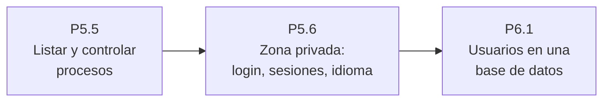

# 🧪 Prácticas de UP5

| Práctica | Temas que necesitas | Agrupamiento | CE |
|:---------|:--------------------|:-------------|:--:|
| [P5.1 Ejercicios básicos de PHP](./1-ejercicios-basicos) | 1 y 2 | Individual | 5a, 5b, 5c, 5d |
| [P5.2 Bucles, arrays y funciones](./2-bucles-arrays-funciones) | 2 a 4 | Individual | 5d, 5e |
| [P5.3 Envío de correos con PHP](./3-envio-correos) | 1 a 4 | Parejas | 5c, 5d, 5e, 5h |
| [P5.4 Formularios con PHP](./4-formularios) | 3 y 5 | Individual | 5d, 5e, 5f |
| [P5.5 Monitorización de procesos](./5-monitorizacion-procesos) | 1 a 5 | Individual | 5b, 5d, 5e, 5f |
| [P5.6 Zona privada con sesiones y cookies](./6-zona-privada) | 5 y 6 | Individual | 5f, 5g, 5h, 5i |

## Un proyecto en tres aproximaciones

Las prácticas P5.5 y P5.6, junto con la [P6.1](/up6/ejercicios/1-autenticacion-bd) de la unidad siguiente, construyen por pasos una misma aplicación: un panel web para que el administrador de una empresa controle a distancia los procesos de un servidor.

Cada aproximación parte del código de la anterior, así que conviene dejarlo ordenado y comentado desde el principio.

## Cómo se evalúan

Cada práctica tiene su rúbrica, con un elemento evaluable por cada criterio de evaluación que recoge. Todas usan la [escala de niveles 0–4](/general/contenidos/3-evaluacion) del módulo.
