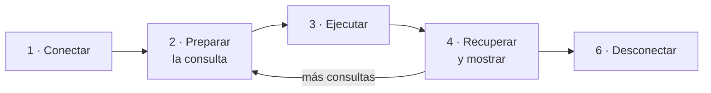

# 🗄️ Tema 1 — Acceso a datos con PDO

<ExportPDF />

::: info-box Diapositivas del tema
Este tema tiene presentación de clase: [ver las diapositivas](../diapositivas/1-acceso-datos).
:::

## Introducción

PHP actúa como una interfaz para MySQL: permite que los resultados de las consultas SQL se presenten en una página web. Desde PHP puedes conectarte a MySQL con tus credenciales y realizar consultas, lo que facilita el manejo dinámico de bases de datos en las aplicaciones web.

MySQL (y su derivado libre MariaDB) es el sistema gestor más habitual en entornos web, pero no el único: también se usan PostgreSQL, Oracle Database o Microsoft Access, entre otros. **PDO** (*PHP Data Objects*) es la extensión de PHP que ofrece una misma forma de trabajar con todos ellos: cambia la cadena de conexión, pero el resto del código es el mismo.

## Proceso de acceso a una base de datos con PHP

1. **Conectar a MySQL** y seleccionar la base de datos que se va a utilizar.
2. **Preparar una consulta** en formato de cadena de texto.
3. **Ejecutar la consulta** a través de PHP.
4. **Recuperar los resultados** y mostrarlos en una página web.
5. Repetir los pasos 2 a 4 hasta obtener toda la información deseada.
6. **Desconectar** de MySQL.



## Configuración previa: activar la extensión

Antes de escribir código hay que comprobar que PHP tiene activada la extensión de PDO para MySQL.

1. **Habilitar la extensión PDO en el fichero de configuración de PHP** (`php.ini`). En AMPPS se abre desde el botón *PHP conf* de la versión de PHP en uso. La línea debe quedar sin el punto y coma inicial, que es la marca de comentario:

   ```ini
   ;extension=openssl
   ;extension=pdo_firebird
   extension=pdo_mysql
   ;extension=pdo_oci
   ```

2. **Añadir la extensión `php_pdo_mysql.dll` en el apartado *Extensions* de AMPPS**, marcando su casilla.

Después hay que reiniciar Apache para que el cambio tenga efecto.

::: tip-box Comprueba que está activa
Crea un archivo con `<?php phpinfo(); ?>` y busca la sección **PDO** en la página que genera: debe aparecer `mysql` entre los *drivers* habilitados.
:::

## La tabla de ejemplo

Los ejemplos del tema usan una tabla `usuarios` con las columnas `id` y `nombre`. Puedes crearla desde phpMyAdmin con este SQL:

```sql
CREATE TABLE usuarios (
    id INT AUTO_INCREMENT PRIMARY KEY,
    nombre VARCHAR(100) NOT NULL
);

INSERT INTO usuarios (nombre) VALUES
    ('Juan Pérez'),
    ('Ana García'),
    ('David López'),
    ('Marta Rodríguez'),
    ('Alberto Huertas'),
    ('Jacinto López');
```

## Paso a paso

### 1. Datos de la conexión

Se definen los datos de la conexión y, con ellos, el **DSN** (*Data Source Name*): la cadena que especifica el tipo de base de datos y su configuración.

```php
<?php
// 1. Configuración de la conexión
$host    = 'localhost';
$db      = 'nombre_de_tu_bd';
$user    = 'tu_usuario';
$pass    = 'tu_contraseña';
$charset = 'utf8mb4';

// El DSN (Data Source Name) especifica el tipo de BD y la configuración
$dsn = "mysql:host=$host;dbname=$db;charset=$charset";
```

### 2. Opciones y apertura de la conexión

Antes de conectar se configuran las propiedades de PDO, y la conexión se abre dentro de un bloque `try` para poder capturar los errores.

```php
$options = [
    PDO::ATTR_ERRMODE            => PDO::ERRMODE_EXCEPTION,
    PDO::ATTR_DEFAULT_FETCH_MODE => PDO::FETCH_ASSOC,
    PDO::ATTR_EMULATE_PREPARES   => false,
];

try {
    // 2. Abrir la conexión
    $pdo = new PDO($dsn, $user, $pass, $options);
```

| Opción | Efecto |
|:-------|:-------|
| `PDO::ATTR_ERRMODE => PDO::ERRMODE_EXCEPTION` | Los errores de base de datos lanzan una excepción `PDOException`, que se puede capturar con `catch`. |
| `PDO::ATTR_DEFAULT_FETCH_MODE => PDO::FETCH_ASSOC` | Cada fila se devuelve como un array asociativo, con el nombre de la columna como clave. |
| `PDO::ATTR_EMULATE_PREPARES => false` | Las sentencias preparadas las resuelve el propio servidor de base de datos. |

### 3 y 4. Ejecución de la consulta y muestra de resultados

```php
    // 3. Ejecutar la consulta
    $stmt = $pdo->query("SELECT * FROM usuarios");

    // 4. Mostrar los resultados
    echo "<h2>Lista de Usuarios</h2>";
    echo "<ul>";

    while ($row = $stmt->fetch()) {
        // Suponiendo que tu tabla tiene columnas 'id' y 'nombre'
        echo "<li>ID: " . htmlspecialchars($row['id']) .
             " - Nombre: " . htmlspecialchars($row['nombre']) . "</li>";
    }

    echo "</ul>";
```

`query` ejecuta la consulta y devuelve un objeto con el resultado. Cada llamada a `fetch` devuelve la fila siguiente, o `false` cuando ya no quedan: por eso sirve como condición del `while`.

### 5. Cierre de la conexión

```php
    // Cerrar la sentencia (buena práctica)
    $stmt = null;

    // Cerrar la conexión
    $pdo = null;
    echo "Conexión cerrada exitosamente.";

} catch (PDOException $e) {
    echo "Error: " . $e->getMessage();
}
?>
```

Si cualquier operación falla (credenciales incorrectas, base de datos inexistente, error en el SQL), la ejecución salta al bloque `catch`, que muestra el mensaje de error.

::: warning-box No muestres el error tal cual en producción
El mensaje de una `PDOException` puede revelar nombres de tablas, de usuarios o rutas del servidor. En una aplicación publicada se registra en un fichero de *log* y al usuario se le muestra un mensaje genérico.
:::

## El script completo

```php
<?php
// 1. Configuración de la conexión
$host    = 'localhost';
$db      = 'nombre_de_tu_bd';
$user    = 'tu_usuario';
$pass    = 'tu_contraseña';
$charset = 'utf8mb4';

// El DSN (Data Source Name) especifica el tipo de BD y la configuración
$dsn = "mysql:host=$host;dbname=$db;charset=$charset";

$options = [
    PDO::ATTR_ERRMODE            => PDO::ERRMODE_EXCEPTION,
    PDO::ATTR_DEFAULT_FETCH_MODE => PDO::FETCH_ASSOC,
    PDO::ATTR_EMULATE_PREPARES   => false,
];

try {
    // 2. Abrir la conexión
    $pdo = new PDO($dsn, $user, $pass, $options);

    // 3. Ejecutar la consulta
    $stmt = $pdo->query("SELECT * FROM usuarios");

    // 4. Mostrar los resultados
    echo "<h2>Lista de Usuarios</h2>";
    echo "<ul>";

    while ($row = $stmt->fetch()) {
        // Suponiendo que tu tabla tiene columnas 'id' y 'nombre'
        echo "<li>ID: " . htmlspecialchars($row['id']) .
             " - Nombre: " . htmlspecialchars($row['nombre']) . "</li>";
    }

    echo "</ul>";

    // Cerrar la sentencia (buena práctica)
    $stmt = null;

    // Cerrar la conexión
    $pdo = null;
    echo "Conexión cerrada exitosamente.";

} catch (PDOException $e) {
    echo "Error: " . $e->getMessage();
}
?>
```

### Resultado final

Con la tabla `usuarios` de ejemplo, la página muestra:

```text
Lista de Usuarios

 • ID: 1 - Nombre: Juan Pérez
 • ID: 2 - Nombre: Ana García
 • ID: 3 - Nombre: David López
 • ID: 4 - Nombre: Marta Rodríguez
 • ID: 5 - Nombre: Alberto Huertas
 • ID: 6 - Nombre: Jacinto López

Conexión cerrada exitosamente.
```

## Consultas con datos del usuario: sentencias preparadas

`query` es adecuado cuando la consulta es un texto fijo. Cuando la consulta incluye un dato que viene de un formulario, **no se debe insertar la variable dentro del texto SQL**: se usa una sentencia preparada, en la que el dato viaja separado de la consulta.

```php
// El signo ? marca el lugar del dato
$stmt = $pdo->prepare("SELECT * FROM usuarios WHERE nombre = ?");
// El dato se pasa aparte, al ejecutar
$stmt->execute([$_POST['nombre']]);
$row = $stmt->fetch();

if ($row) {
    echo "Usuario encontrado: " . htmlspecialchars($row['nombre']);
} else {
    echo "Usuario no encontrado";
}
```

::: danger-box Inyección de SQL
Si se escribe `"... WHERE nombre = '$nombre'"`, un usuario puede introducir en el formulario un texto que cierre la comilla y añada su propio SQL, con lo que podría saltarse un inicio de sesión o leer y borrar datos. Con las sentencias preparadas, lo que escribe el usuario se trata siempre como un dato, nunca como parte de la consulta.
:::

## Ejercicios propuestos

1. Añade un nuevo campo a la tabla `usuarios` y modifica el ejemplo para que muestre el resultado por pantalla dentro de una tabla HTML (`<table>`).
2. Dado el formulario de usuario y contraseña de temas anteriores, comprueba si dicho usuario está o no en la tabla y, en caso de estar, muéstrale la zona privada.

---

**Siguiente tema:** [Crear, consultar, modificar y borrar datos →](./2-crud-pdo)
