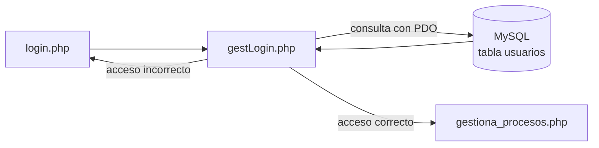

# 📋 P6.1 — Monitorización de sistemas: acceso a base de datos

<ExportPDF />

::: info-box Ficha de la práctica
- **Unidad:** UP6 · RA6.
- **Criterios de evaluación:** 6b, 6c, 6e, 6f, 6g.
- **Proyecto:** tercera aproximación del [panel de control de procesos](/up5/ejercicios/).
- **Punto de partida:** la zona privada de la [P5.6](/up5/ejercicios/6-zona-privada).
- **Entrega:** código PHP comentado y demostración de su funcionamiento.
:::

## Objetivos

1. Realizar páginas privadas a las que solo sea posible entrar después de que el administrador se haya identificado, comprobando su usuario y contraseña en una tabla de una base de datos.
2. Entender y hacer uso de PDO como herramienta para acceder a los datos de una base de datos MySQL desde PHP.

## Descripción

Se debe integrar, en la práctica realizada, la comprobación del usuario y la contraseña contra los datos de la tabla `usuarios` de una base de datos MySQL.

## Requisitos

1. La extensión de PDO para MySQL está activada en PHP.
2. Existe una base de datos MySQL con una tabla `usuarios` que guarda los usuarios y sus contraseñas.
3. `gestLogin.php` se conecta a la base de datos con PDO y comprueba en la tabla el usuario y la contraseña recibidos del formulario.
4. El resto del comportamiento de la aplicación (sesiones, cookie de idioma, mensajes de error y zona privada) se mantiene como en la P5.6.

## Entregable

- Código PHP de la aplicación, comentado.
- Estructura de la tabla `usuarios`.
- Demostración del funcionamiento: acceso correcto con un usuario de la tabla, acceso incorrecto y comportamiento si la base de datos no está disponible.

## Rúbrica

Escala común del módulo: [niveles 0–4](/general/contenidos/3-evaluacion). El nivel 0 corresponde a no entregado o sin relación con lo solicitado.

| Elemento evaluable | Nivel 1 | Nivel 2 | Nivel 3 | Nivel 4 |
|:-------------------|:--------|:--------|:--------|:--------|
| **Integración de PHP con MySQL** CE 6b | La extensión no está activa o no se sabe comprobarlo. | La extensión de PDO para MySQL está activada y se muestra cómo se ha comprobado. | Explica qué hace la extensión y qué cambiaría con otro sistema gestor. | La comprobación queda descrita de forma que otra persona puede repetirla en su equipo. |
| **Conexión con PDO** CE 6c | No se establece la conexión, o se usa una extensión distinta de PDO. | Conexión con PDO correcta, con el DSN y las opciones definidos. | Justifica las opciones de conexión elegidas y captura los errores con `try…catch`. | Los datos de conexión están en un único archivo, reutilizado por toda la aplicación. |
| **Consulta de los datos de usuario** CE 6e | La consulta falla o no devuelve el usuario buscado. | Se obtiene de la tabla `usuarios` el registro del usuario que intenta acceder. | Explica cómo se recorre el resultado y qué ocurre cuando el usuario no existe. | La consulta se integra con las sesiones y los mensajes de error de la aproximación anterior sin duplicar código. |
| **Seguridad en el acceso** CE 6f | La consulta se construye concatenando los datos del formulario, o las contraseñas están en texto claro. | Se usan sentencias preparadas y las contraseñas se guardan cifradas con un *hash*. | Justifica frente a qué ataques protege cada medida. | El criterio de seguridad es el mismo en todas las páginas y se explica con claridad en la demostración. |
| **Verificación del funcionamiento** CE 6g | No se muestran pruebas, o solo el caso de acceso correcto. | Se comprueban el acceso correcto y el incorrecto con usuarios de la tabla. | Se prueba también el fallo de conexión a la base de datos y se explica el comportamiento esperado. | Las pruebas están ordenadas y descritas de forma que se pueden repetir. |

---

**Siguiente práctica:** [P6.2 Gestión de una tabla desde PHP →](./2-crud)
